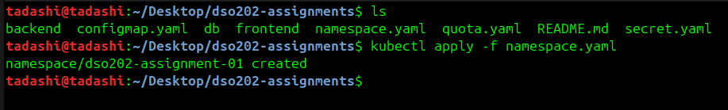
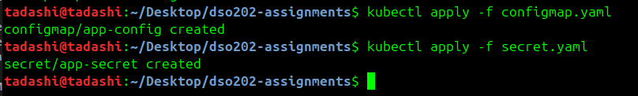
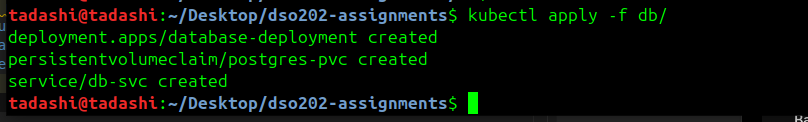
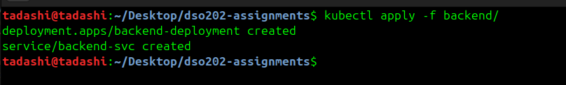

# DSO202 — Assignment 1: Three-Tier Application Deployment

---

## Task 1: Architecture Note

### 1. Control-Plane & Node Components Involvement
When deploying the three application Pods (Frontend, Backend, Database), several Kubernetes components interact sequentially across the control plane and worker nodes:

* **kube-apiserver**: Acts as the central gateway. It receives, validates, and authenticates all incoming declarative YAML manifests submitted via `kubectl apply`.
* **etcd**: Serves as the distributed key-value storage where the desired state of all cluster objects (Namespace, ConfigMaps, Secrets, Deployments, PVC, Services) is persisted.
* **kube-controller-manager**: Watches the state of objects via `etcd`. Controllers (such as the DeploymentController and ReplicaSetController) continuously work to align the actual state of Pods with the desired replica counts.
* **kube-scheduler**: Evaluates unscheduled Pods created by the ReplicaSetController. It analyzes Pod resource requests/limits alongside worker node capacity to bind each Pod to an appropriate worker node.
* **kubelet (Worker Node)**: The node agent that detects newly assigned Pods. It communicates with the local container runtime (`containerd`) to pull the required container images, sets up volume mounts (such as the PostgreSQL PVC), and manages container execution.
* **kube-proxy (Worker Node)**: Maintains local network routing rules on each node to handle IP translation and ensure seamless service discovery and inter-tier communication across Pods.

### 2. Kubernetes Objects Used Per Tier & Rationale
* **Database Tier**:
  * **PersistentVolumeClaim (PVC)**: Used to request persistent block storage backed by `kind`'s local provisioner. This ensures PostgreSQL data mounted at `/var/lib/postgresql/data` persists independently of Pod lifecycles.
  * **Deployment**: Configured with `replicas: 1` to ensure stateful stability while maintaining automatic Pod recovery.
  * **Headless Service (`clusterIP: None`)**: Exposes the database Pod directly within the namespace via internal DNS without allocating a virtual IP or load balancing overhead, which is optimal for direct database connections.
* **Backend Tier**:
  * **Deployment**: Manages the stateless API instance, handling automatic restarts and rollouts.
  * **ClusterIP Service**: Exposes internal container port `8080` strictly within the namespace (`dso202-assignment-01`), preventing unauthorized external exposure.
* **Frontend Tier**:
  * **Deployment**: Serves the Nginx-based frontend static assets.
  * **NodePort Service**: Maps internal container port `8080` to a host node port, allowing host browser access while keeping internal traffic contained.



---

## Task 2: Secret Encoding Security Caveat

> **Security Note on Kubernetes Secrets**:  
> Kubernetes Secrets are base64-encoded strings, **not encrypted at rest by default**. Anyone with read access to the namespace or underlying `etcd` store can decode these values using simple base64 utilities (e.g., `echo '<base64-string>' | base64 --decode`). In a production environment, Secrets should be encrypted at rest within `etcd` using EncryptionConfiguration and managed via external secret managers (such as HashiCorp Vault or AWS Secrets Manager).

Created configmap.yaml that store all non-sensitive configuration keys in a single ConfigMap object. You must include keys for both variable naming conventions (DB_* for the backend and POSTGRES_* for the database image):

```YAML
apiVersion: v1
kind: ConfigMap
metadata:
  name: app-config
  namespace: dso202-assignment-01
data:
  DB_HOST: "db-svc"
  DB_PORT: "5432"
  DB_NAME: "taskdb"
  APP_PORT: "8080"
  CORS_ORIGIN: "*"
  POSTGRES_DB: "taskdb"
  BACKEND_URL: "http://backend-svc:8080"
```
Create secret.yaml that stores all sensitive credentials in a single Secret object using either stringData or base64 encoding:

```YAML
apiVersion: v1
kind: Secret
metadata:
  name: app-secret
  namespace: dso202-assignment-01
type: Opaque
stringData:
  DB_USER: "postgres"
  DB_PASSWORD: "Ds(53)22-32190"
  POSTGRES_USER: "postgres"
  POSTGRES_PASSWORD: "Ds(53)22-32190"
```



## Task 3 : Database Tier
Database Tier sets up the data storage, container deployment, and internal networking for PostgreSQL database.

1. **PersistentVolumeClaim** : It request the persistent disk storage from kind's built-in storage provisioner so database rows persist even if the database Pod crashes or gets recreated.

```YAML
apiVersion: v1
kind: PersistentVolumeClaim
metadata:
  name: postgres-pvc
  namespace: dso202-assignment-01
spec:
  accessModes:
    - ReadWriteOnce
  resources:
    requests:
      storage: 1Gi
```
2. **Database Deployment** : it deploys a single database replica which means replicas:1 and mounts the PVC at `/var/lib/postgresql/data` and imports the POSTGRES_* environment variables.

```YAML
apiVersion: apps/v1
kind: Deployment
metadata:
  name: database-deployment
  namespace: dso202-assignment-01
  labels:
    tier: database
spec:
  replicas: 1
  selector:
    matchLabels:
      tier: database
  template:
    metadata:
      labels:
        tier: database
    spec:
      containers:
      - name: postgres
        image: sarojsanyasi/dso202-db:1.0
        ports:
        - containerPort: 5432
        env:
        - name: POSTGRES_DB
          valueFrom:
            configMapKeyRef:
              name: app-config
              key: POSTGRES_DB
        - name: POSTGRES_USER
          valueFrom:
            secretKeyRef:
              name: app-secret
              key: POSTGRES_USER
        - name: POSTGRES_PASSWORD
          valueFrom:
            secretKeyRef:
              name: app-secret
              key: POSTGRES_PASSWORD
        volumeMounts:
        - name: postgres-storage
          mountPath: /var/lib/postgresql/data
      volumes:
      - name: postgres-storage
        persistentVolumeClaim:
          claimName: postgres-pvc
```
3. Headless Service : it exposes the database internally inside the namespace. Using clusterIP: None (Headless Service) tells Kubernetes DNS to route traffic directly to the Pod's IP without allocating a virtual IP or applying unnecessary proxy load balancing.

```YAML
apiVersion: v1
kind: Service
metadata:
  name: db-svc
  namespace: dso202-assignment-01
  labels:
    tier: database
spec:
  clusterIP: None
  selector:
    tier: database
  ports:
  - port: 5432
    targetPort: 5432
```


## Task 4 : Backend Tier
Backend Tier deploys the application's REST API layer and exposes it safely inside the cluster using internal networking by following ways : 
1. Deploys the Backend REST using the image sarojsanyasi/dso202-backend:1.0 to run the core application logic. It consumes environment variables matching the DB_* naming scheme (DB_HOST, DB_PORT, DB_NAME, DB_USER, DB_PASSWORD, APP_PORT, CORS_ORIGIN). Plus it configures DB_HOST to point directly to db-svc (the database's headless Service name created in Task 3) so the API can establish a database connection.

```YAML
apiVersion: apps/v1
kind: Deployment
metadata:
  name: backend-deployment
  namespace: dso202-assignment-01
  labels:
    tier: backend
spec:
  replicas: 1
  selector:
    matchLabels:
      tier: backend
  template:
    metadata:
      labels:
        tier: backend
    spec:
      containers:
      - name: backend
        image: sarojsanyasi/dso202-backend:1.0
        ports:
        - containerPort: 8080
        env:
        - name: DB_HOST
          valueFrom:
            configMapKeyRef:
              name: app-config
              key: DB_HOST
        - name: DB_PORT
          valueFrom:
            configMapKeyRef:
              name: app-config
              key: DB_PORT
        - name: DB_NAME
          valueFrom:
            configMapKeyRef:
              name: app-config
              key: DB_NAME
        - name: APP_PORT
          valueFrom:
            configMapKeyRef:
              name: app-config
              key: APP_PORT
        - name: CORS_ORIGIN
          valueFrom:
            configMapKeyRef:
              name: app-config
              key: CORS_ORIGIN
        - name: DB_USER
          valueFrom:
            secretKeyRef:
              name: app-secret
              key: DB_USER
        - name: DB_PASSWORD
          valueFrom:
            secretKeyRef:
              name: app-secret
              key: DB_PASSWORD
```
2. Exposes the Backend Internally creating a ClusterIP Service named backend-svc listening on port 8080. It keeps the REST API strictly isolated inside the dso202-assignment-01 namespace, ensuring it is unreachable from external browsers or outside network interfaces.

```YAML
apiVersion: v1
kind: Service
metadata:
  name: backend-svc
  namespace: dso202-assignment-01
  labels:
    tier: backend
spec:
  type: ClusterIP
  selector:
    tier: backend
  ports:
  - port: 8080
    targetPort: 8080
```



## Task 6: Resource Governance Justification

* **ResourceQuota Justification**:
  * **CPU (`requests.cpu: "1"`, `limits.cpu: "2"`)**: Provides enough processing power for all three containers (Nginx, API runtime, PostgreSQL engine) to startup and execute concurrent requests without choking the `kind` cluster host.
  * **Memory (`requests.memory: 1Gi`, `limits.memory: 2Gi`)**: PostgreSQL requires baseline memory for buffer pools, while Node.js/Nginx require lightweight memory allocations. A 1Gi request ensures memory scheduling reservations while 2Gi limit prevents Out-Of-Memory (OOM) host issues.
* **LimitRange Justification**:
  * Sets default container requests (`250m` CPU, `256Mi` Memory) and default limits (`500m` CPU, `512Mi` Memory). This prevents any single container missing explicit limits from consuming unbounded node resources.

---

## Task 7: Verification & Evidence

### a. Full CRUD Cycle Demonstration
*Attach terminal transcript or browser screenshots demonstrating task creation, reading, updating, and deletion.*

```bash
# Example CRUD Verification Transcript
# 1. Create a Task
curl -X POST http://localhost:8080/api/tasks -H "Content-Type: application/json" -d '{"title":"Test Task"}'

# 2. Get Tasks
curl http://localhost:8080/api/tasks# 02230306-DSO202-Assignments
