# DSO202 — Assignment 1: Three-Tier Application Deployment on Kubernetes


## Repository Structure

```
assignment-1/
├── Assignment1-report.md      # this report
├── 00-namespace.yaml          # Task 1 - namespace
├── 01-configmap.yaml          # Task 2 - non-sensitive config (DB_*, POSTGRES_DB, BACKEND_URL ...)
├── 02-secret.yaml             # Task 2 - credentials (DB_USER/PASSWORD, POSTGRES_USER/PASSWORD)
├── quota.yaml                 # Task 6 - ResourceQuota + LimitRange
├── rbac.yaml                  # Task 8 (bonus) - read-only ServiceAccount, Role, RoleBinding
├── database/                  # Task 3
│   ├── pvc.yaml
│   ├── deployment.yaml
│   └── service.yaml           #   headless (clusterIP: None)
├── backend/                   # Task 4
│   ├── deployment.yaml
│   └── service.yaml           #   ClusterIP
├── frontend/                  # Task 5
│   ├── deployment.yaml
│   └── service.yaml           #   NodePort 30081
├── evidence/                  # Task 7 - full, unedited terminal transcripts
├── assets/                    # screenshots
└── Assignment-1-app-code/     # app source provided with the brief (images built from this)
```

Files are numbered (`00-`, `01-`, `02-`) so that `kubectl apply` order is obvious: the namespace must exist before anything is created in it, and the ConfigMap/Secret must exist before Pods that reference them start.

```bash
cd assignment-1
kubectl apply -f 00-namespace.yaml
kubectl apply -f quota.yaml
kubectl apply -f 01-configmap.yaml -f 02-secret.yaml
kubectl apply -f database/ -f backend/ -f frontend/
kubectl apply -f rbac.yaml                      # optional bonus
kubectl get all,pvc -n dso202-assignment-01
```

Full transcript: [`evidence/01-apply.txt`](evidence/01-apply.txt), resulting state: [`evidence/02-state.txt`](evidence/02-state.txt).

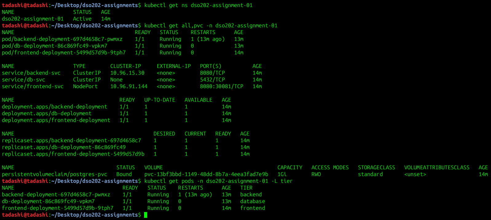

---

## Prerequisite & Troubleshooting — Running arm64 Images on an amd64 Cluster

The tutor-issued images (`sarojsanyasi/dso202-frontend:1.0`, `dso202-backend:1.0`, `dso202-db:1.0`) are published **for `linux/arm64` only**, while the kind nodes run on `amd64`. My first deployment therefore sat in `ImagePullBackOff` — containerd on the nodes could not find a manifest matching the node's platform:

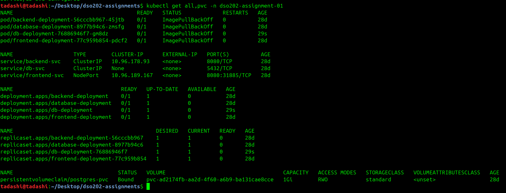

Because the brief forbids substituting our own images, the fix keeps the exact issued images and runs them under **QEMU user-mode emulation** (already registered in the Docker Desktop VM's `binfmt_misc`, so the kind node containers — which share that kernel — can execute arm64 binaries):

```bash
# 1. confirm emulation works
docker run --rm --platform linux/arm64 alpine:3.20 uname -m        # -> aarch64

# 2. pull the arm64 variant of each issued image
for t in frontend backend db; do
  docker pull --platform linux/arm64 sarojsanyasi/dso202-$t:1.0
done

# 3. import them into every node's containerd
#    (`kind load docker-image` fails here with "failed to detect containerd snapshotter",
#     a known kind / containerd 2.x incompatibility, so the image is imported directly)
for t in frontend backend db; do
  docker save --platform linux/arm64 -o dso202-$t.tar sarojsanyasi/dso202-$t:1.0
  for n in dso202-control-plane dso202-worker dso202-worker2; do
    docker exec -i $n ctr -n k8s.io images import --platform linux/arm64 - < dso202-$t.tar
  done
done
```

Every Deployment sets `imagePullPolicy: IfNotPresent`, so the kubelet uses the pre-loaded image instead of trying to pull an incompatible one. The trade-off is that emulated containers use more CPU (PostgreSQL's first-time `initdb` took ~15 s) — this is reflected in the CPU limits chosen in Task 6.

---

## Task 1 — Namespace and Architecture Note

```yaml
apiVersion: v1
kind: Namespace
metadata:
  name: dso202-assignment-01
  labels:
    name: dso202-assignment-01
```

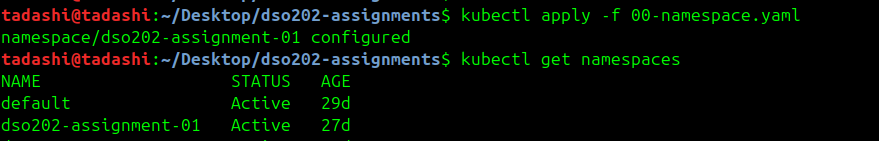

A dedicated namespace provides a scope for names, a boundary for ResourceQuota/LimitRange (Task 6) and RBAC (Task 8), and makes the whole assignment removable with a single `kubectl delete namespace`.

### Architecture note components involved in scheduling and running each Pod

The same control-plane path is followed for all three tiers when a manifest is applied:

1. **`kube-apiserver`** — `kubectl apply` sends the manifest to the API server, which authenticates the request, checks RBAC, runs admission control (this is where the **ResourceQuota** and **LimitRange** admission plugins inject default resources and reject over-quota objects), and persists the object.
2. **`etcd`** — stores the desired state (Deployments, Services, ConfigMap, Secret, PVC).
3. **`kube-controller-manager`** — the *Deployment controller* creates a ReplicaSet; the *ReplicaSet controller* creates the Pod objects and later recreates them if they disappear (Task 7c); the *Endpoints/EndpointSlice controller* links each Service to matching Pod IPs; the *PV controller* binds the PVC.
4. **`kube-scheduler`** — picks a worker node for each unscheduled Pod based on resource requests and node capacity. For the database Pod, scheduling also triggers the `standard` StorageClass (`WaitForFirstConsumer`) so the volume is provisioned on the node the Pod lands on.
5. **`kubelet`** (on the chosen worker) — tells **containerd** to start the container, injects the ConfigMap/Secret values as environment variables, mounts the PVC, and restarts the container if it exits.
6. **`kube-proxy`** (every node) — programs the routing rules that make each ClusterIP/NodePort Service reach its Pods. **CoreDNS** (a cluster add-on) resolves Service names such as `backend-svc` and `db-svc`.

### Object selection per tier

| Tier | Objects | Why |
| --- | --- | --- |
| **Database** | PersistentVolumeClaim, Deployment (1 replica, `Recreate`), **headless** Service | Data must outlive the Pod, so it lives on a PVC. One replica because a plain PostgreSQL instance cannot share its data directory; `Recreate` makes the old Pod release the `ReadWriteOnce` volume before the new one starts. A headless Service (`clusterIP: None`) gives a stable DNS name that resolves directly to the Pod IP, and is never reachable from outside the cluster. |
| **Backend** | Deployment, **ClusterIP** Service | Stateless, so a Deployment can freely replace it. ClusterIP gives a stable virtual IP and DNS name (`backend-svc`) inside the cluster only, so the API is never exposed to the host. |
| **Frontend** | Deployment, **NodePort** Service | Stateless nginx. NodePort is the only Service type here that opens a port on the nodes, so it is the single entry point from outside the cluster. |
| **Shared** | ConfigMap, Secret, ResourceQuota, LimitRange | Configuration separated from images; namespace-wide resource governance. |

Every Pod, Deployment and Service carries a `tier` label (`frontend` / `backend` / `database`) plus `app: task-tracker`. Service selectors use both labels.

---

## Task 2 — Configuration and Secrets

Configuration is injected at runtime rather than built into the images.

**`app-config` (ConfigMap)** — non-sensitive values ([`01-configmap.yaml`](01-configmap.yaml)):

| Key | Value | Consumed by |
| --- | --- | --- |
| `DB_HOST` | `db-svc` | backend |
| `DB_PORT` | `5432` | backend |
| `DB_NAME` | `taskdb` | backend |
| `APP_PORT` | `8080` | backend |
| `CORS_ORIGIN` | `*` | backend |
| `POSTGRES_DB` | `taskdb` | database |
| `BACKEND_URL` | `http://backend-svc:8080` | frontend |

**`app-secret` (Secret)** — credentials only ([`02-secret.yaml`](02-secret.yaml)): `DB_USER`, `DB_PASSWORD`, `POSTGRES_USER`, `POSTGRES_PASSWORD`.

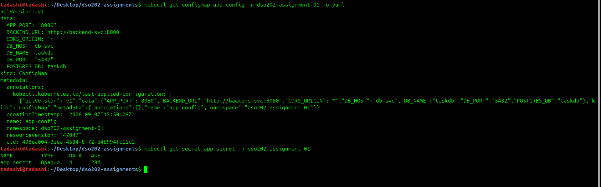

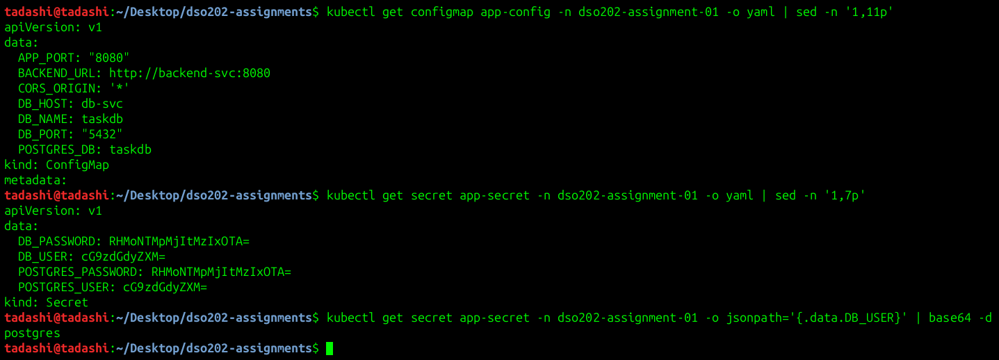

### `DB_*` vs `POSTGRES_*` mapping

The backend and the official PostgreSQL image use **different variable names for the same values**, so both sets are supplied and must match:

| Backend reads | Database image reads | Shared value | Stored in |
| --- | --- | --- | --- |
| `DB_NAME` | `POSTGRES_DB` | `taskdb` | ConfigMap |
| `DB_USER` | `POSTGRES_USER` | (same user) | Secret |
| `DB_PASSWORD` | `POSTGRES_PASSWORD` | (same password) | Secret |

Each Deployment references **only its own keys** with explicit `configMapKeyRef` / `secretKeyRef` entries rather than `envFrom`. The database Pod never receives `DB_*` or `BACKEND_URL`, and the frontend never receives any credential (least privilege, and it documents in the manifest exactly which variables each tier depends on).

### Secret encoding caveat

> **Kubernetes Secrets are base64-encoded, not encrypted.** Base64 is a reversible text encoding, not a security control. Anyone who can read the Secret can decode it:
> ```bash
> kubectl get secret app-secret -n dso202-assignment-01 -o jsonpath='{.data.DB_PASSWORD}' | base64 -d
> ```
> By default `etcd` also stores Secrets **unencrypted at rest** unless the API server is configured with an `EncryptionConfiguration` (or an external KMS provider).

In this repository the Secret is written with `data:` (base64), so no credential appears as plaintext in a committed file. That is still only obfuscation: anyone with repository access can decode it. In production the protection would come from RBAC on Secrets (see Task 8, where the read-only role deliberately cannot read Secrets), encryption at rest, and keeping real credentials out of Git entirely (Sealed Secrets, External Secrets Operator, or Vault). Per the brief, this is documented here rather than fixed.

---

## Task 3 — Database Tier

Manifests: [`database/pvc.yaml`](database/pvc.yaml), [`database/deployment.yaml`](database/deployment.yaml), [`database/service.yaml`](database/service.yaml)

- **PVC `postgres-pvc`**: 1 Gi, `ReadWriteOnce`, StorageClass `standard` (kind's default, `rancher.io/local-path`). Status `Bound`.
- **Deployment `db-deployment`**: `replicas: 1`, `strategy: Recreate`, image `sarojsanyasi/dso202-db:1.0`, consumes `POSTGRES_DB` (ConfigMap) and `POSTGRES_USER` / `POSTGRES_PASSWORD` (Secret), and mounts the PVC at `/var/lib/postgresql/data`.
- **Service `db-svc`**: `clusterIP: None` (headless), port 5432, no NodePort or LoadBalancer.

```
NAME                   TYPE        CLUSTER-IP     EXTERNAL-IP   PORT(S)          SELECTOR
service/db-svc         ClusterIP   None           <none>        5432/TCP         app=task-tracker,tier=database

NAME                                 STATUS   VOLUME                                     CAPACITY   ACCESS MODES   STORAGECLASS
persistentvolumeclaim/postgres-pvc   Bound    pvc-13bf3bbd-1149-48dd-8b7a-4eea3fad7e9b   1Gi        RWO            standard
```

The image's init script seeded three sample tasks on first start.

---

## Task 4 — Backend Tier

Manifests: [`backend/deployment.yaml`](backend/deployment.yaml), [`backend/service.yaml`](backend/service.yaml)

- **Deployment `backend-deployment`**: image `sarojsanyasi/dso202-backend:1.0`, consumes `DB_HOST=db-svc`, `DB_PORT`, `DB_NAME`, `APP_PORT`, `CORS_ORIGIN` (ConfigMap) and `DB_USER`, `DB_PASSWORD` (Secret).
- **Service `backend-svc`**: `type: ClusterIP`, port 8080. It has no node port, so it is unreachable from the host.

The backend's startup retry is visible in its logs. It started before PostgreSQL finished initialising, kept retrying, and connected without crashing:

```
[db] not reachable yet (ECONNREFUSED), retrying in 2000ms
[db] not reachable yet (ECONNREFUSED), retrying in 2000ms
...
[db] connected
[server] listening on :8080
```

> CORS is set to `*` for classroom simplicity. A production deployment would restrict it to the frontend's known origin.

---

## Task 5 — Frontend Tier

Manifests: [`frontend/deployment.yaml`](frontend/deployment.yaml), [`frontend/service.yaml`](frontend/service.yaml)

- **Deployment `frontend-deployment`**: image `sarojsanyasi/dso202-frontend:1.0`, consumes `BACKEND_URL=http://backend-svc:8080`. The image's entrypoint renders this into `/config.js` at container start (verified in [`evidence/04-dns.txt`](evidence/04-dns.txt)). It runs as non-root (`uid=101(nginx)`).
- **Service `frontend-svc`**: `type: NodePort`, `8080:30081`.

**NodePort choice:** 30080 was already allocated by `webapp-dev` in the `dso202-dev` namespace from the practicals (`provided port is already allocated`), so **30081** is used.

**Reaching it from the host:** this kind cluster was created **without** `extraPortMappings`, so the NodePort is not published to `localhost`. As the brief allows, `kubectl port-forward` is used instead:

```bash
kubectl port-forward -n dso202-assignment-01 svc/frontend-svc 8081:8080
# -> http://localhost:8081   (HTTP 200, "Field Log — Task Tracker")
```

To expose it directly, the cluster would need to be recreated with:

```yaml
nodes:
- role: control-plane
  extraPortMappings:
  - containerPort: 30081
    hostPort: 30081
```

**Note on `BACKEND_URL` and the browser:** `config.js` is executed by the *browser*, not inside the cluster, so the browser itself must resolve `backend-svc`. That name only exists in cluster DNS. For a browser demo, also run `kubectl port-forward -n dso202-assignment-01 svc/backend-svc 8080:8080` and add `127.0.0.1 backend-svc` to `/etc/hosts`. On this machine local port 8080 is already used by Jenkins, so the browser screenshot below was taken by forwarding the backend to port 18080 and pointing the browser at a small local HTTP proxy that routes `backend-svc:8080` to it. The brief explicitly allows Task 7a to be done with `curl` through a port-forwarded backend, which is how it is evidenced below. A production setup would avoid this by having nginx reverse-proxy `/api` to `backend-svc`, or by using an Ingress.

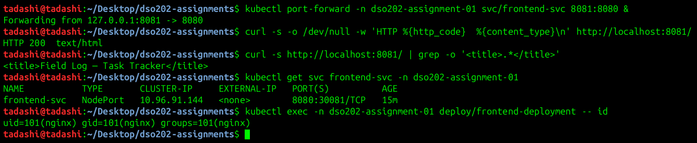

The Task Tracker UI, loaded through `kubectl port-forward` with `backend-svc` routed to the port-forwarded backend. The tasks shown come from PostgreSQL, and the badge reads **"BACKEND + DB ONLINE"**:


Frontend evidence: [`evidence/09-frontend.txt`](evidence/09-frontend.txt)

---

## Task 6 — Namespace Resource Governance

Manifest: [`quota.yaml`](quota.yaml)

### Per-container requests and limits (set explicitly in each Deployment)

| Tier | CPU request | CPU limit | Memory request | Memory limit | Reasoning |
| --- | --- | --- | --- | --- | --- |
| Database | 250m | 1 | 256Mi | 512Mi | The heaviest tier. PostgreSQL's defaults (`shared_buffers` 128 MB plus per-connection memory) fit in 256Mi at idle, with headroom to 512Mi for queries. The 1-CPU limit absorbs the QEMU emulation overhead during `initdb`. |
| Backend | 100m | 500m | 128Mi | 256Mi | A Node.js process with a small `pg` pool idles around 50–70 MB. 256Mi leaves room for V8 heap growth, and 500m covers emulated JIT startup. |
| Frontend | 50m | 200m | 64Mi | 128Mi | nginx serving static files uses only a few MB and almost no CPU. |
| **Total** | **400m** | **1700m** | **448Mi** | **896Mi** | |

### ResourceQuota `ns-quota`

| Resource | Hard | Used | Justification |
| --- | --- | --- | --- |
| `requests.cpu` | 1 | 400m | ~2.5× the steady-state need. This covers a rolling update of the backend (one extra Pod, +100m) plus a debug Pod, while preventing this namespace from reserving more than 1 of the 8 node CPUs on a shared laptop cluster. |
| `requests.memory` | 1Gi | 448Mi | Same ~2× headroom. Each worker has only ~3.6 GiB allocatable, so this namespace cannot request more than about a quarter of a node. |
| `limits.cpu` | 3 | 1700m | Leaves room for one surge Pod (backend +500m) and a defaulted debug Pod (+250m) under rolling updates. It is higher than usual because emulated arm64 containers burst CPU at startup. |
| `limits.memory` | 2Gi | 896Mi | About 2× current limits. Bounds the worst case at roughly half a worker's memory, so the namespace cannot cause node-level OOM. |
| `pods` | 8 | 3 | 3 app Pods + rolling-update surge + `kubectl run` debug Pods. It also stops a runaway controller. |
| `services` | 5 | 3 | 3 Services + room for the imperative comparison in Task 7d. |
| `services.nodeports` | 1 | 1 | **Enforces the brief:** only the frontend may be exposed outside the cluster. |
| `services.loadbalancers` | 0 | 0 | **Enforces the brief:** no LoadBalancer Services are allowed. |
| `persistentvolumeclaims` / `requests.storage` | 2 / 2Gi | 1 / 1Gi | One 1Gi database volume, plus room for one more (for example, a backup) without letting the namespace fill the node's disk. |

### LimitRange `ns-limits`

| Setting | Value | Justification |
| --- | --- | --- |
| `defaultRequest` | 100m / 128Mi | Any container that omits requests (for example, an ad-hoc `kubectl run`) still gets a request. This is **required** once a ResourceQuota on `requests.*` exists, because otherwise such Pods would be rejected. |
| `default` (limit) | 250m / 256Mi | A safe cap for unlabelled debug containers, roughly backend-sized. |
| `max` | 1 CPU / 1Gi | No single container may claim more than the largest legitimate need (the database). |
| `min` | 25m / 32Mi | Rejects unrealistically small values that would cause throttling or OOM-kill loops. |
| PVC `max` / `min` | 2Gi / 500Mi | Keeps individual volume claims within the quota and the node's disk. |

### Enforcement evidence ([`evidence/08-quota-rbac.txt`](evidence/08-quota-rbac.txt))

```
$ kubectl create service loadbalancer lb-test --tcp=80:80 -n dso202-assignment-01
error: ... forbidden: exceeded quota: ns-quota, requested: services.loadbalancers=1 ... limited: services.loadbalancers=0

$ kubectl create service nodeport np-test --tcp=80:80 -n dso202-assignment-01
error: ... forbidden: exceeded quota: ns-quota, requested: services.nodeports=1, used: services.nodeports=1, limited: services.nodeports=1

$ kubectl run greedy ... (requests/limits cpu: 2)
Error from server (Forbidden): pods "greedy" is forbidden: maximum cpu usage per Container is 1, but limit is 2

$ kubectl run defaults-demo --image=sarojsanyasi/dso202-frontend:1.0 --restart=Never
$ kubectl get pod defaults-demo -o jsonpath='{.spec.containers[0].resources}'
{"limits":{"cpu":"250m","memory":"256Mi"},"requests":{"cpu":"100m","memory":"128Mi"}}   <- injected by LimitRange
```

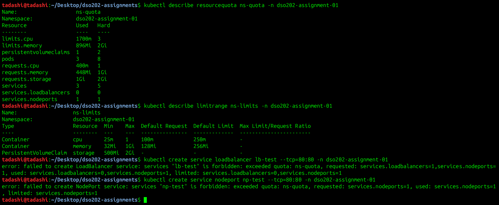

---

## Task 7 — Verification and Interactivity

### 7a. Full CRUD cycle ([`evidence/03-crud.txt`](evidence/03-crud.txt))

Performed with `curl` through a port-forwarded backend Service:

```
$ kubectl port-forward -n dso202-assignment-01 svc/backend-svc 18080:8080 &

$ curl -s http://localhost:18080/api/status
{"status":"ok","db":"connected"}

# CREATE
$ curl -s -X POST http://localhost:18080/api/tasks -H 'Content-Type: application/json' \
       -d '{"title":"Persistence check","description":"Created before backend pod deletion"}'
{"id":4,"title":"Persistence check","description":"Created before backend pod deletion","status":"pending",...}
$ curl -s -X POST http://localhost:18080/api/tasks -H 'Content-Type: application/json' \
       -d '{"title":"Write assignment README","description":"DSO202 Assignment 1"}'
{"id":5,"title":"Write assignment README","description":"DSO202 Assignment 1","status":"pending",...}

# READ (list + one)
$ curl -s http://localhost:18080/api/tasks
[{"id":1,...},{"id":2,...},{"id":3,...},{"id":4,...},{"id":5,...}]
$ curl -s http://localhost:18080/api/tasks/5
{"id":5,"title":"Write assignment README",...,"status":"pending",...}

# UPDATE
$ curl -s -X PUT http://localhost:18080/api/tasks/5 -H 'Content-Type: application/json' \
       -d '{"title":"Write assignment README","description":"DSO202 Assignment 1","status":"done"}'
{"id":5,"title":"Write assignment README","description":"DSO202 Assignment 1","status":"done",...}

# DELETE
$ curl -s -o /dev/null -w 'HTTP %{http_code}\n' -X DELETE http://localhost:18080/api/tasks/5
HTTP 204
$ curl -s -w '\nHTTP %{http_code}\n' http://localhost:18080/api/tasks/5
{"error":"task not found"}
HTTP 404
```

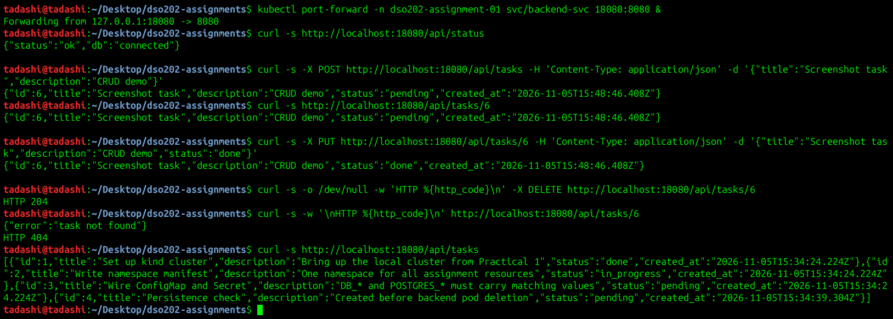

Task 4 is kept on purpose for the persistence test in 7c.

### 7b. Service DNS resolution from inside the frontend Pod ([`evidence/04-dns.txt`](evidence/04-dns.txt))

```
$ kubectl exec -n dso202-assignment-01 deploy/frontend-deployment -- cat /etc/resolv.conf
search dso202-assignment-01.svc.cluster.local svc.cluster.local cluster.local
nameserver 10.96.0.10

$ kubectl exec -n dso202-assignment-01 deploy/frontend-deployment -- nslookup backend-svc
Name:   backend-svc.dso202-assignment-01.svc.cluster.local
Address: 10.96.15.30            <- the ClusterIP (virtual IP handled by kube-proxy)

$ kubectl exec -n dso202-assignment-01 deploy/frontend-deployment -- nslookup db-svc
Name:   db-svc.dso202-assignment-01.svc.cluster.local
Address: 10.244.1.13            <- headless: resolves straight to the database Pod IP

$ kubectl exec -n dso202-assignment-01 deploy/frontend-deployment -- curl -s http://backend-svc:8080/api/status
{"status":"ok","db":"connected"}

$ kubectl exec -n dso202-assignment-01 deploy/frontend-deployment -- \
    curl -s http://backend-svc.dso202-assignment-01.svc.cluster.local:8080/api/tasks/4
{"id":4,"title":"Persistence check",...}
```

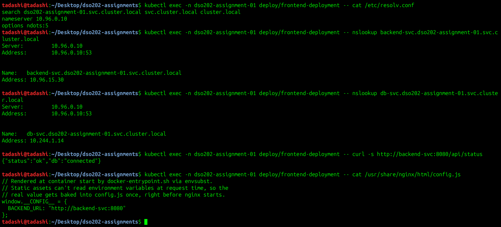

The short name `backend-svc` works because the Pod's `resolv.conf` search list appends `dso202-assignment-01.svc.cluster.local`. The two lookups show the difference between Service types: `backend-svc` returns a stable virtual IP, while the headless `db-svc` returns the Pod's own IP. (The `NXDOMAIN` lines in the full transcript are just busybox `nslookup` trying the other search domains and are harmless.)

### 7c. Self-healing and data persistence ([`evidence/05-self-healing.txt`](evidence/05-self-healing.txt), [`evidence/06-db-persistence.txt`](evidence/06-db-persistence.txt))

**Backend Pod deleted while a second terminal ran `--watch`:**

```
$ kubectl delete pod/backend-deployment-697d4658c7-bsh72 -n dso202-assignment-01
pod "backend-deployment-697d4658c7-bsh72" deleted

$ kubectl get pods -n dso202-assignment-01 -l tier=backend --watch
NAME                                  READY   STATUS              RESTARTS   AGE
backend-deployment-697d4658c7-bsh72   1/1     Running             0          62s
backend-deployment-697d4658c7-bsh72   1/1     Terminating         0          64s
backend-deployment-697d4658c7-pwmxz   0/1     Pending             0          0s
backend-deployment-697d4658c7-pwmxz   0/1     ContainerCreating   0          0s
backend-deployment-697d4658c7-pwmxz   1/1     Running             0          1s

$ kubectl describe rs -n dso202-assignment-01 -l tier=backend | tail -3
  Normal  SuccessfulCreate  77s   replicaset-controller  Created pod: backend-deployment-697d4658c7-bsh72
  Normal  SuccessfulCreate  13s   replicaset-controller  Created pod: backend-deployment-697d4658c7-pwmxz

$ kubectl exec -n dso202-assignment-01 deploy/frontend-deployment -- curl -s http://backend-svc:8080/api/tasks/4
{"id":4,"title":"Persistence check","description":"Created before backend pod deletion","status":"pending",...}
```

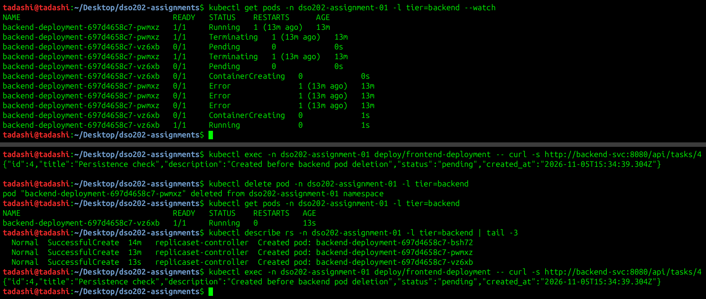

The ReplicaSet controller noticed the actual count (0) no longer matched the desired count (1) and created a replacement within a second. The new Pod has a new name and IP, but `backend-svc` followed it automatically through its label selector. Task 4, created before the deletion, is still returned.

**Going further: deleting the database Pod.** The backend holds no data, so deleting it alone does not really test storage. The database Pod was also deleted:

```
$ kubectl delete pod -n dso202-assignment-01 -l tier=database
pod "db-deployment-86c869fc49-ktsrm" deleted
$ kubectl get pod,pvc -n dso202-assignment-01 -l tier=database
pod/db-deployment-86c869fc49-vpkm7   1/1     Running   0          1s
persistentvolumeclaim/postgres-pvc   Bound    pvc-13bf3bbd-1149-48dd-8b7a-4eea3fad7e9b   1Gi   RWO   standard

$ kubectl logs -n dso202-assignment-01 deploy/db-deployment | grep -E 'Skipping initialization|ready'
PostgreSQL Database directory appears to contain a database; Skipping initialization
LOG:  database system is ready to accept connections

$ kubectl exec ... curl -s http://backend-svc:8080/api/tasks/4
{"id":4,"title":"Persistence check",...}
```

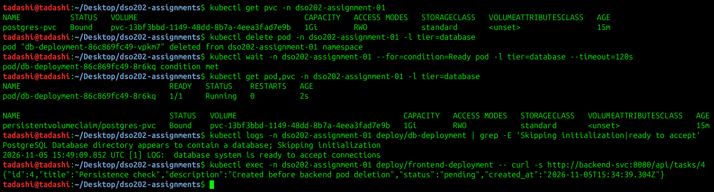

The new database Pod attached the **same PV** (`pvc-13bf3bbd…`), found an existing data directory, skipped re-initialisation, and served task 4. This shows that **Pod lifecycle and PersistentVolume lifecycle are independent**: Pods are disposable, while the PVC (and the data) remains until the claim itself is deleted.

**Observation:** when the database Pod was deleted, the backend container restarted once (`RESTARTS 1`). The old PostgreSQL process closed the backend's idle pooled connection (`terminating connection due to administrator command`). The issued backend image does not handle errors on idle pool connections, so Node.js exited. The **kubelet** restarted the container (`restartPolicy: Always`), and the image's startup retry loop then reconnected (`[db] connected`). This is a second layer of self-healing: the kubelet restarts the *container*, while the ReplicaSet replaces the *Pod*. A readiness probe (outside Unit I scope) would also keep traffic away during that window.

### 7d. Declarative vs. imperative ([`evidence/07-declarative-vs-imperative.txt`](evidence/07-declarative-vs-imperative.txt))

The backend ClusterIP Service was created both ways.

**Declarative** (from `backend/service.yaml`):

```
$ kubectl apply -f backend/service.yaml
service/backend-svc unchanged                <- re-applying is idempotent
$ kubectl diff -f backend/service.yaml; echo "exit code: $?"
exit code: 0                                 <- live object matches the file in Git
```

**Imperative** equivalent:

```
$ kubectl expose deployment backend-deployment --name=backend-svc-imperative \
    --type=ClusterIP --port=8080 --target-port=8080 -n dso202-assignment-01
service/backend-svc-imperative exposed
$ kubectl expose deployment backend-deployment --name=backend-svc-imperative ...   # run again
Error from server (AlreadyExists): services "backend-svc-imperative" already exists

$ kubectl get svc backend-svc backend-svc-imperative -n dso202-assignment-01 -o wide
NAME                     TYPE        CLUSTER-IP     PORT(S)    SELECTOR
backend-svc              ClusterIP   10.96.15.30    8080/TCP   app=task-tracker,tier=backend
backend-svc-imperative   ClusterIP   10.96.166.29   8080/TCP   app=task-tracker,tier=backend

$ kubectl exec -n dso202-assignment-01 deploy/frontend-deployment -- curl -s http://backend-svc-imperative:8080/api/status
{"status":"ok","db":"connected"}

$ kubectl delete svc backend-svc-imperative -n dso202-assignment-01      # cleanup
```

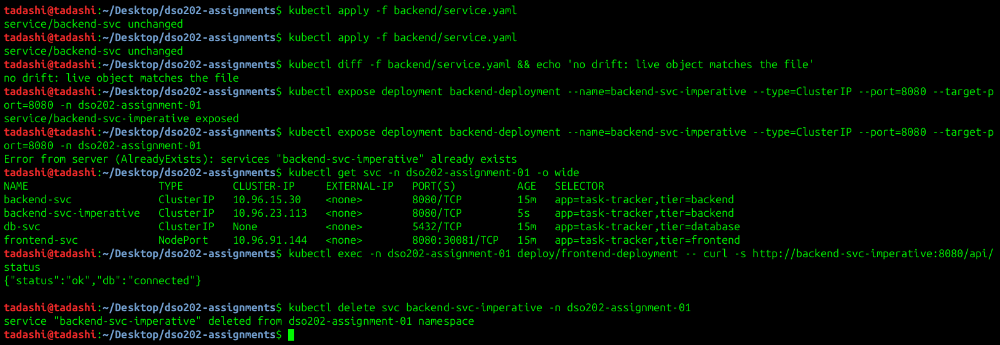

Both produce a working Service with the same selector and endpoint. A naive `kubectl create service clusterip backend-svc --tcp=8080:8080 --dry-run=client -o yaml` would generate `selector: app: backend-svc`, which matches **no Pods**. Imperative commands rely on implicit defaults that are easy to get wrong.

| Aspect | Declarative (`kubectl apply -f`) | Imperative (`kubectl create/expose/run`) |
| --- | --- | --- |
| What you express | The desired end state | The action to perform |
| Re-running | Idempotent (`unchanged`) | Fails (`AlreadyExists`) or creates duplicates |
| Source of truth | YAML in Git: reviewable, versioned, reproducible | Shell history only; nothing to review or roll back |
| Updates and drift | `kubectl diff` shows drift; edit the file and re-apply. `apply` records `last-applied-configuration` for 3-way merges. | Separate `edit`/`patch`/`set` commands; no record of intended state (the imperative Service has no `last-applied-configuration` annotation) |
| Labels and selectors | Explicit, and the `tier` label is guaranteed | Generated defaults that may not match (see the `create service` example) |
| Best for | Everything that must be reproducible: this assignment, CI/CD, GitOps | Quick experiments, debugging, and generating starter YAML with `--dry-run=client -o yaml` |

**Conclusion:** imperative commands are faster for one-off tasks and useful for scaffolding YAML. The declarative approach is the right default for a real deployment because the repository *is* the deployment: it is idempotent, reviewable, diffable and reproducible on any cluster.

---

## Task 8 (Bonus) — Namespace RBAC

Manifest: [`rbac.yaml`](rbac.yaml). It creates a ServiceAccount `readonly-sa`, a Role `readonly-role` (`get`/`list`/`watch` on Pods, logs, Services, Endpoints, ConfigMaps, PVCs, Deployments and ReplicaSets, with **no Secrets**), and a RoleBinding that ties them together inside `dso202-assignment-01` only.

```
$ kubectl auth can-i get pods          -n dso202-assignment-01 --as=system:serviceaccount:dso202-assignment-01:readonly-sa   -> yes
$ kubectl auth can-i list deployments  -n dso202-assignment-01 --as=...readonly-sa   -> yes
$ kubectl auth can-i watch services    -n dso202-assignment-01 --as=...readonly-sa   -> yes
$ kubectl auth can-i get secrets       -n dso202-assignment-01 --as=...readonly-sa   -> no   (credentials hidden)
$ kubectl auth can-i delete pods       -n dso202-assignment-01 --as=...readonly-sa   -> no
$ kubectl auth can-i create deployments -n dso202-assignment-01 --as=...readonly-sa  -> no
$ kubectl auth can-i get pods          -n default              --as=...readonly-sa   -> no   (namespace-scoped)

$ kubectl delete pod -l tier=frontend -n dso202-assignment-01 --as=...readonly-sa
Error from server (Forbidden): ... cannot delete resource "pods" in API group "" in the namespace "dso202-assignment-01"
```

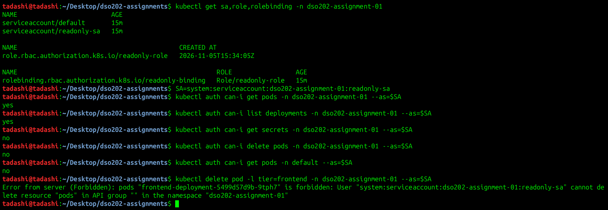

---
