# DSO202 — Assignment 2: Applying Unit II to the Assignment 1 Task Tracker

| Unit II topic | Assignment 1 design | Assignment 2 design |
| --- | --- | --- |
| **2.1 StatefulSets** | Database = single-replica Deployment + one hand-made PVC | Database = **StatefulSet `db`** with `volumeClaimTemplates`, an explicit PVC retention policy, and a stable per-Pod DNS name (`db-0.db-svc`) used by the backend |
| **2.2 Ingress** | Frontend exposed by a **NodePort**; browser could not reach the API (`backend-svc` only exists in cluster DNS) | **NGINX Ingress** with TLS for `tasktracker.local`: `/` → frontend, `/api` → backend. Every Service is ClusterIP and the quota forbids NodePorts entirely. The browser problem from Assignment 1 is fixed. |
| **2.3 RBAC** | All Pods ran as the namespace `default` ServiceAccount with an API token mounted; one bonus read-only SA | A dedicated ServiceAccount per tier with **no token mounted**; read-only viewer; least-privilege CD **deployer** (with the `update`/`patch` pitfall reproduced and fixed); the built-in `view` ClusterRole reused for a group through a RoleBinding |
| **Unit II practical — CSR user** | Only the cluster-admin kubeconfig existed | A real user **`tadashi`** (group `dev-team`) authenticated by an x509 certificate signed through the CSR API, with its own kube context |
| **2.4 Operators** | Only built-in resource types | A **`TaskTracker` CRD** describing the whole app in domain terms, with schema validation that enforces the Assignment 1 rules at the API server, plus **aggregated ClusterRoles** |

> **Not covered:** 2.5 Service Mesh (Istio) is listed in the notes' introduction but its section is not in the provided notes, so it is out of scope here.

---

## Repository Structure

```
assignment-2/
├── 00-namespace.yaml
├── 01-configmap.yaml            # DB_HOST=db-0.db-svc, BACKEND_URL="." (same-origin via Ingress)
├── 02-secret.yaml
├── 03-quota.yaml                # services.nodeports: 0, services.loadbalancers: 0
├── 04-serviceaccounts.yaml      # frontend-sa / backend-sa / db-sa, automountServiceAccountToken: false
├── database/
│   ├── service.yaml             # headless db-svc (governing Service)
│   └── statefulset.yaml         # 2.1
├── backend/                     # Deployment + ClusterIP
├── frontend/                    # Deployment + ClusterIP (was NodePort)
├── ingress-controller/
│   └── ingress-nginx-kind.yaml  # NGINX Ingress controller v1.15.1, kind provider manifest (pinned copy)
├── ingress/
│   └── ingress.yaml             # 2.2 - TLS, host + path routing, NGINX annotations
├── rbac/
│   ├── viewer.yaml              # 2.3 read-only ServiceAccount
│   ├── deployer.yaml            # 2.3 least-privilege CD ServiceAccount
│   └── developer.yaml           # 2.3 group + user bindings for the CSR user
├── user/
│   └── create-user.sh           # CSR practical: key -> CSR -> approve -> kubeconfig context
├── operator/
│   ├── crd.yaml                 # 2.4 TaskTracker CRD with OpenAPI validation
│   ├── tasktracker.yaml         # a valid Custom Resource
│   ├── tasktracker-invalid.yaml # deliberately invalid CR (validation demo)
│   └── aggregate-clusterrole.yaml
├── assets/                      # screenshots
├── evidence/                    # raw terminal transcripts behind every screenshot
├── .gitignore                   # *.key *.crt *.csr *.kubeconfig - credentials never committed
└── README.md
```

### How to deploy

```bash
cd assignment-2
# Ingress controller (cluster-wide, once per cluster)
kubectl apply -f ingress-controller/ingress-nginx-kind.yaml
kubectl wait -n ingress-nginx --for=condition=ready pod -l app.kubernetes.io/component=controller --timeout=600s

# Application
kubectl apply -f 00-namespace.yaml -f 03-quota.yaml -f 01-configmap.yaml -f 02-secret.yaml -f 04-serviceaccounts.yaml
kubectl apply -f database/ -f backend/ -f frontend/

# TLS certificate (self-signed, git-ignored) + Ingress
openssl req -x509 -nodes -newkey rsa:2048 -days 30 \
  -keyout ingress/tasktracker.key -out ingress/tasktracker.crt \
  -subj "/CN=tasktracker.local/O=DSO202" -addext "subjectAltName=DNS:tasktracker.local"
kubectl create secret tls tasktracker-tls -n dso202-assignment-02 \
  --cert=ingress/tasktracker.crt --key=ingress/tasktracker.key
kubectl apply -f ingress/ingress.yaml

# RBAC, CRD, CSR user
kubectl apply -f rbac/
kubectl apply -f operator/crd.yaml -f operator/aggregate-clusterrole.yaml -f operator/tasktracker.yaml
./user/create-user.sh
```

The images are arm64-only and must already be loaded on the nodes (see the Assignment 1 README, "Prerequisite & Troubleshooting"); every workload uses `imagePullPolicy: IfNotPresent`.

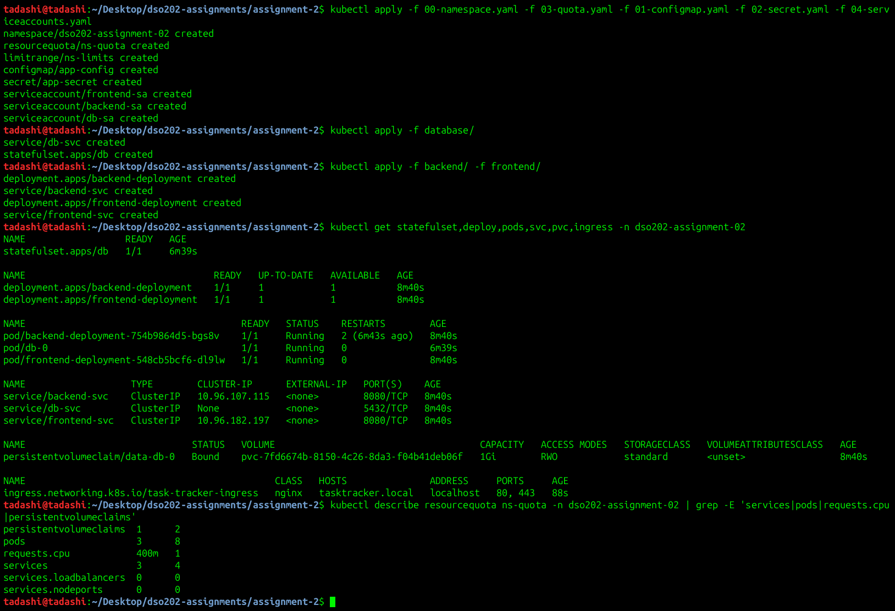

---

## 2.1 StatefulSet — Database Tier

**Why the database moves to a StatefulSet.** In Assignment 1 the database was a Deployment with one manually created PVC. That works for a single replica, but the Pod had a random name (`db-deployment-86c869fc49-vpkm7`) and the PVC's link to the Pod lived only in the Pod template. A StatefulSet makes the identity part of the API: the Pod is always **`db-0`**, its PVC is generated from a template and is always **`data-db-0`**, and the governing headless Service gives it a DNS record that never changes: **`db-0.db-svc.dso202-assignment-02.svc.cluster.local`**.

Key fields ([`database/statefulset.yaml`](database/statefulset.yaml)):

| Field | Value | Reason |
| --- | --- | --- |
| `serviceName` | `db-svc` | Must name the **headless** Service. A ClusterIP Service would not create per-Pod DNS records. |
| `replicas` | `1` | The issued PostgreSQL image has no replication logic. A StatefulSet guarantees stable identity, but it does **not** make the application use it (notes §2.1.9). A second replica would be a separate, empty database with its own `data-db-1`, and the backend would see different data depending on which Pod answered. Replication would need an Operator such as CloudNativePG (§2.4). |
| `podManagementPolicy` | `OrderedReady` | Default ordered start and stop. Stated explicitly as the notes recommend. |
| `volumeClaimTemplates` | `data`, 1Gi, `standard` | One PVC per ordinal (`data-db-0`), re-attached to the same ordinal after rescheduling. |
| `persistentVolumeClaimRetentionPolicy` | `whenDeleted: Retain`, `whenScaled: Retain` | Set explicitly so that deleting or scaling the StatefulSet can never silently delete the database. |
| `updateStrategy.rollingUpdate.partition` | `0` | Ready for a canary rollout (notes §2.1.8) if replicas are ever increased. |
| `DB_HOST` (ConfigMap) | `db-0.db-svc` | The backend targets **ordinal 0** by its stable name, instead of the Service name used in Assignment 1. |

### Evidence — stable identity and DNS

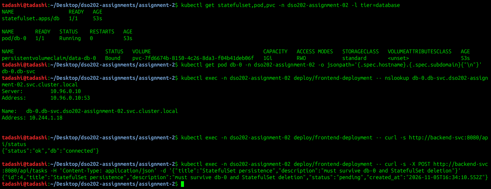

`hostname.subdomain` = `db-0.db-svc`. The per-Pod DNS name resolves to the Pod IP, and the backend reports `"db":"connected"` through it. A task (#4) is created to test persistence.

### Evidence — Pod deleted: same name, same PVC, new IP

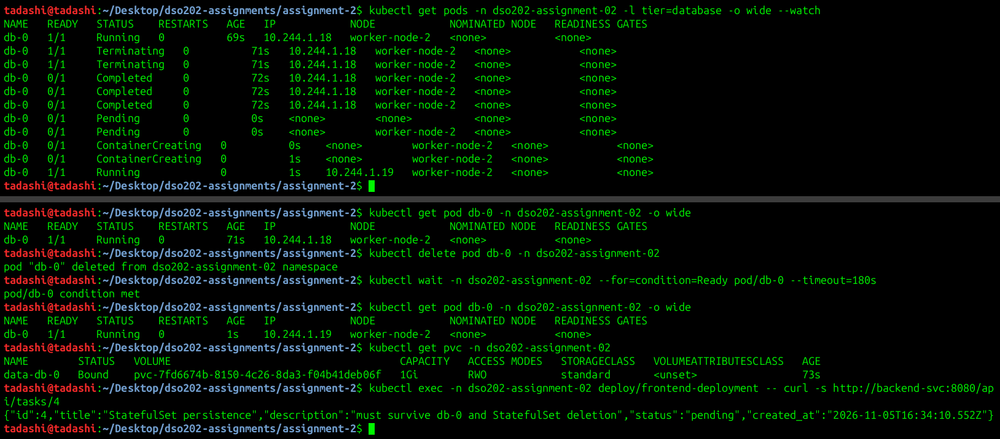

The StatefulSet controller recreated the Pod with the **same name `db-0`**, on the same volume `data-db-0` (`pvc-7fd6674b…`), and task #4 was still there. Its **IP changed** (10.244.1.18 → 10.244.1.19), which is exactly why the backend connects by DNS name rather than by IP.

### Evidence — StatefulSet deleted: PVC retained, data re-attached

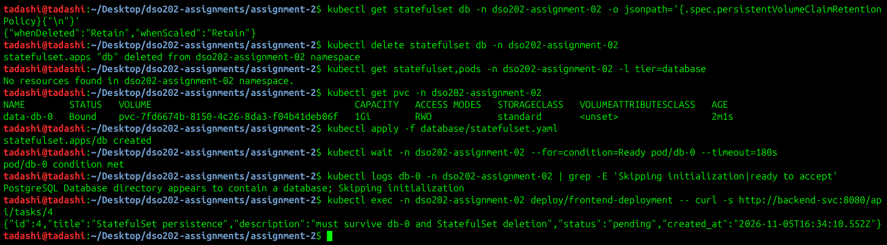

With `whenDeleted: Retain`, deleting the StatefulSet removed the Pod but left `data-db-0` `Bound`. Re-applying the manifest re-attached the claim. PostgreSQL logged *"Database directory appears to contain a database; Skipping initialization"*, and task #4 was returned again.

> **Observation (same as Assignment 1):** each database restart made the backend container restart once, because the issued backend image does not handle errors on idle pooled connections. The kubelet restarts it, and its startup retry loop reconnects. A readiness probe would keep traffic away during that window.

---

## 2.2 Ingress — Single HTTPS Entry Point

### Problem carried over from Assignment 1

In Assignment 1 the frontend was a NodePort and `BACKEND_URL` was `http://backend-svc:8080`. That address is evaluated **in the browser**, where `backend-svc` does not resolve, so the UI could only show tasks with an `/etc/hosts` hack and a second port-forward.

### Design

```
 Browser  https://tasktracker.local
    |
    v
 ingress-nginx-controller (Service, LoadBalancer -> <pending> on kind, reached by port-forward)
    |   1. TLS terminated with Secret "tasktracker-tls"
    |   2. Host "tasktracker.local" matched against Ingress "task-tracker-ingress"
    |   3. /api  (Prefix) -> backend-svc:8080   (ClusterIP)
    |      /     (Prefix) -> frontend-svc:8080  (ClusterIP)
    v
 Pods (plain HTTP inside the cluster only)
```

- **One origin for page and API.** `BACKEND_URL` is now `"."`, so the page calls `./api/tasks`, which is the same host and port that served it, and the Ingress routes that to the backend. No cross-origin request, no CORS dependency, no cluster DNS needed in the browser. (The image's entrypoint replaces an empty value with a default, so `"."` is used instead of `""`.) `CORS_ORIGIN` is also narrowed from `*` to `https://tasktracker.local`.
- **No NodePorts.** `frontend-svc` is ClusterIP, and the quota sets `services.nodeports: "0"`, so a NodePort cannot be created by accident.
- **`ingressClassName: nginx`**, not the deprecated `kubernetes.io/ingress.class` annotation.
- **Annotations** (controller-specific, notes §2.2.5): `ssl-redirect: "true"` (HTTP → 308 → HTTPS) and `proxy-body-size: "1m"`. **No `rewrite-target`**: the notes' worked example rewrites to `/`, but this backend's routes start with `/api`, so rewriting would break every API call.
- **`pathType: Prefix`**: `/api` matches `/api/tasks` and `/api/tasks/4`, but not `/apiv2` (which falls through to `/` and the frontend).
- **TLS**: a self-signed certificate for `tasktracker.local` with a matching Subject Alternative Name, stored as a `kubernetes.io/tls` Secret. The key and certificate files are git-ignored. In production, cert-manager would issue and renew this automatically.

**Controller note (notes §2.2.6):** the NGINX Ingress Controller entered maintenance mode in March 2026 (no further releases or security fixes). It is used here because it is the controller taught in this unit. A real deployment should plan a move to a maintained controller or to the Gateway API. The version is pinned by keeping a copy of the manifest in `ingress-controller/` rather than applying the moving `main` URL.

### Evidence — controller installed

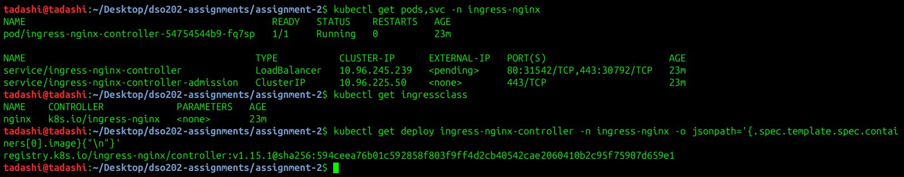

The controller Service is `LoadBalancer` with `EXTERNAL-IP <pending>`, because kind has no cloud load balancer. The cluster was also created without `extraPortMappings`, so the controller is reached with `kubectl port-forward -n ingress-nginx svc/ingress-nginx-controller 8443:443 8088:80`.

### Evidence — TLS Secret

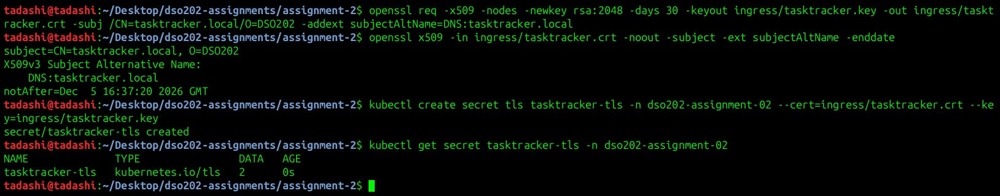

### Evidence — Ingress object

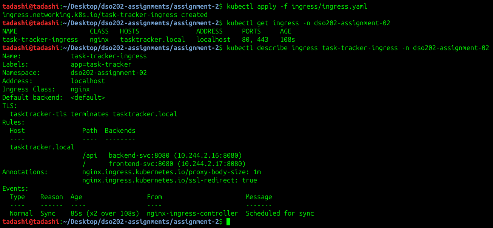

`kubectl describe ingress` shows that TLS is terminated with `tasktracker-tls`, `/api` and `/` already resolve to live endpoint IPs, and both annotations are active. This is the first check in the notes' 502-diagnosis order (§2.2.8): if `Backends` resolves, the Ingress-to-Service link is correct.

### Evidence — routing, TLS and the redirect

Access path: `kubectl port-forward -n ingress-nginx svc/ingress-nginx-controller 8443:443 8088:80`. curl's `--resolve` stands in for an `/etc/hosts` entry (`127.0.0.1 tasktracker.local`).

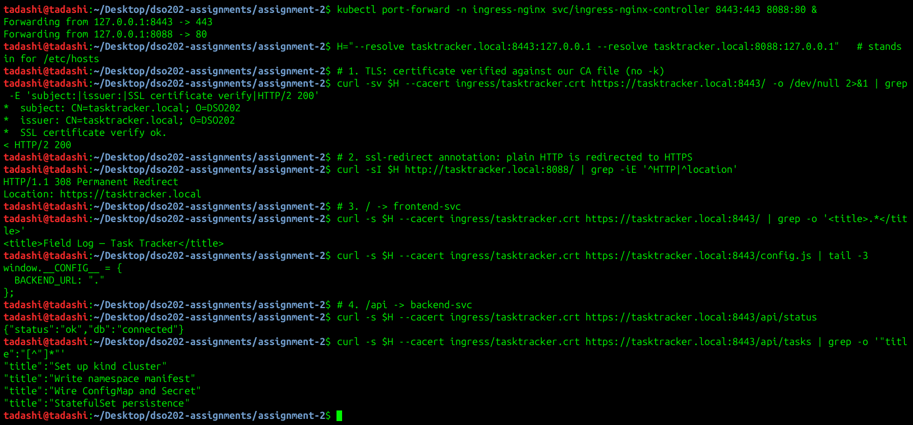

1. **TLS verified properly.** curl checks the server certificate against our certificate file without `-k`: `SSL certificate verify ok`, subject `CN=tasktracker.local`.
2. **`ssl-redirect`**: `http://` → `308 Permanent Redirect` → `https://tasktracker.local`.
3. **`/` → frontend.** `config.js` now contains `BACKEND_URL: "."`.
4. **`/api` → backend**, connected to the database through `db-0.db-svc`.

### Evidence — path matching, virtual hosting, annotation limits

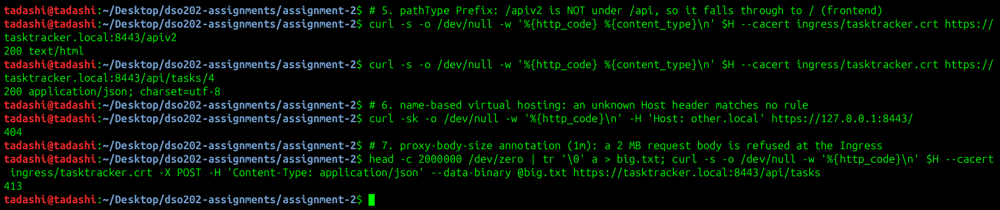

| Request | Result | Shows |
| --- | --- | --- |
| `/apiv2` | `200 text/html` (frontend) | `pathType: Prefix` matches whole path segments, so `/apiv2` is not under `/api` |
| `/api/tasks/4` | `200 application/json` (backend) | Prefix covers sub-paths |
| `Host: other.local` | `404` (controller's default backend) | Name-based virtual hosting: routing is by Host header |
| 2 MB `POST /api/tasks` | `413` (rejected by NGINX) | `proxy-body-size: 1m` annotation enforced before the backend is reached |

### Evidence — full CRUD through the Ingress

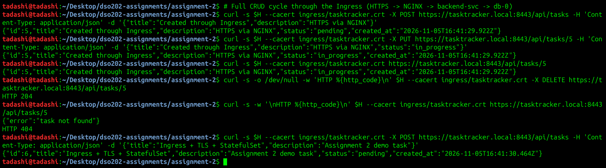

### Evidence — the browser now works end to end (real screenshot)

Headless Chrome, `https://tasktracker.local:8443/` (host mapped to the port-forward; self-signed certificate accepted). The page and its API calls go through the same Ingress host. The list loads from PostgreSQL, the badge reads **"BACKEND + DB ONLINE"**, and the tasks created in the StatefulSet and Ingress demos are visible. In Assignment 1 this needed a hand-written proxy; here it needs nothing.

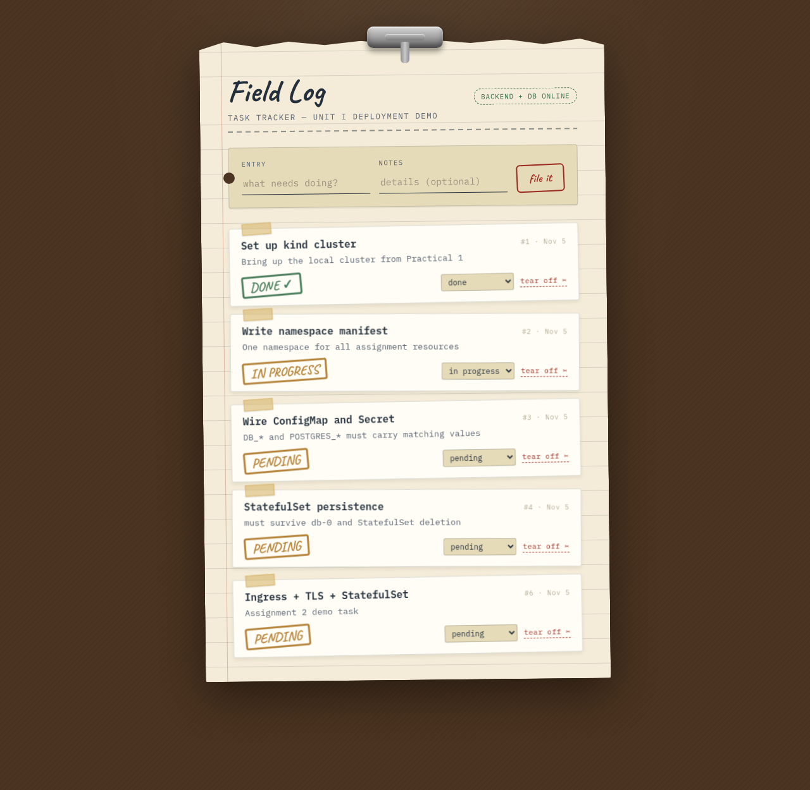

To open it yourself: run the port-forward above, add `127.0.0.1 tasktracker.local` to `/etc/hosts`, browse to `https://tasktracker.local:8443`, and accept the self-signed certificate.

---

## 2.3 RBAC

### Per-workload ServiceAccounts, no API tokens

None of the three tiers calls the Kubernetes API, so each gets its own ServiceAccount (`frontend-sa`, `backend-sa`, `db-sa`) with `automountServiceAccountToken: false` and **no Role bound**. This follows notes §2.3.6: never grant to `default`, and give each workload its own identity.

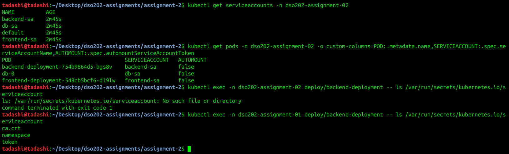

The last two commands show the difference: the Assignment 2 backend has **no** `/var/run/secrets/kubernetes.io/serviceaccount`, while the Assignment 1 backend (namespace `default` SA) has a usable `token`. If the backend were compromised, that token would let an attacker talk to the API server.

### Subjects and their permissions

| Subject | Kind | Binding | Can | Cannot |
| --- | --- | --- | --- | --- |
| `app-viewer` | ServiceAccount | Role `app-reader` (RoleBinding) | get/list/watch Pods, logs, Services, Endpoints, ConfigMaps, PVCs, Deployments, StatefulSets, Ingresses | read Secrets, change anything, see any other namespace |
| `deployer` | ServiceAccount | Role `deployer-role` (RoleBinding) | get/list/watch/create/update/**patch** Deployments, Services, ConfigMaps, Ingresses | delete anything, touch Secrets or the StatefulSet, act outside this namespace |
| `dev-team` | Group (from cert `O=`) | built-in ClusterRole **`view`** via a **RoleBinding** | read most resources in this namespace only, plus TaskTrackers through aggregation | Secrets (excluded from `view` by design), other namespaces |
| `tadashi` | User (from cert `CN=`) | Role `pod-debugger` (RoleBinding) | everything `dev-team` can, plus logs, `exec`, deleting a Pod so its controller recreates it | delete or edit Deployments, Secrets, `kube-system`, nodes |

Binding the **ClusterRole** `view` with a **RoleBinding** applies the scope rule from the notes: *the scope of a grant comes from the binding type, not the role type.* `dev-team` gets `view` in `dso202-assignment-02` only.

### Evidence — read-only viewer

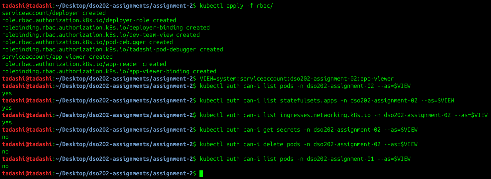

### Evidence — deployer and the `update` vs `patch` pitfall (notes §2.3.8)

The scenario from the notes was reproduced on this app. `patch` was removed from the deployer's Deployment rule, leaving `update`. The pipeline's change was then **Forbidden** (*"cannot patch resource deployments"*) even though `kubectl auth can-i update` said `yes`, because `kubectl apply`, `annotate`, `set` and similar commands send **PATCH** requests to existing objects. `kubectl describe role` showed the missing verb. The fix was to re-apply the committed Role, which adds exactly that one verb, not to bind `cluster-admin`. The deployer still cannot delete, read Secrets, modify the StatefulSet, or act in Assignment 1's namespace.

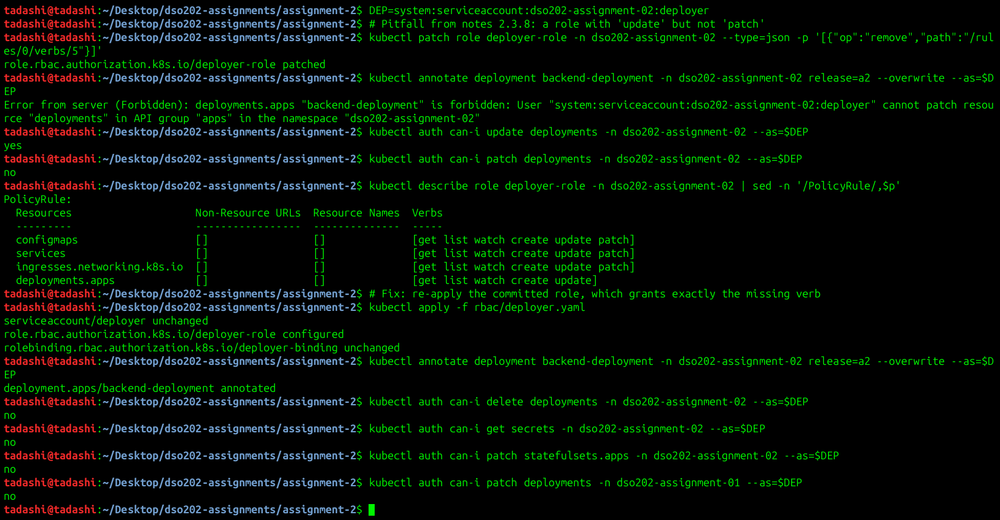

---

## Unit II Practical — Creating a User with the CSR API

Kubernetes has **no User object**. "Creating a user" means (1) issuing a credential the API server trusts (authentication) and (2) binding RBAC to the name inside it (authorization). [`user/create-user.sh`](user/create-user.sh) follows the practical's steps:

1. `openssl genrsa` → private key (stays on this machine, git-ignored).
2. `openssl req -subj "/CN=tadashi/O=dev-team"` → CSR. **CN becomes the username, O becomes a group.**
3. A `CertificateSigningRequest` object with `signerName: kubernetes.io/kube-apiserver-client` and `usages: [client auth]`, the only combination the API server accepts for client login.
4. `kubectl certificate approve` → `Approved,Issued`. The certificate is signed by the cluster CA (`issuer=CN=kubernetes`).
5. RBAC: [`rbac/developer.yaml`](rbac/developer.yaml).
6. `kubectl config set-credentials --embed-certs=true` and 7. `set-context tadashi-dev --cluster=kind-dso202 --namespace=dso202-assignment-02`.

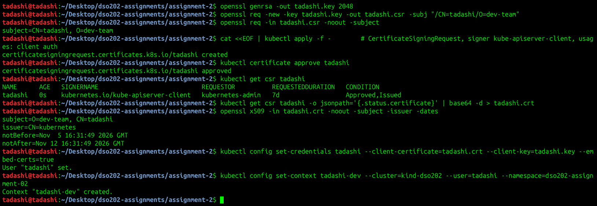

### Evidence — the context in use

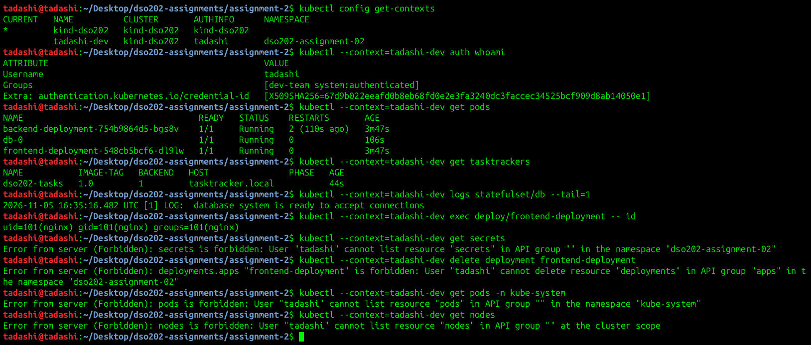

`kubectl auth whoami` shows that the API server authenticated the certificate as **user `tadashi`, groups `[dev-team system:authenticated]`**. Allowed actions work: listing Pods, listing TaskTrackers (through `view` aggregation), logs, exec. The **failures are the real test** (practical, step 8): Secrets, deleting a Deployment, `kube-system` Pods and cluster-scoped nodes are all `Forbidden`. That proves the user's own identity is in use and not the admin credential. All checks used `--context=tadashi-dev`, so the admin context was never switched.

**Expiry choice.** `expirationSeconds: 604800` (7 days) instead of the practical's 90 days. Kubernetes cannot revoke an x509 client certificate (no CRL or OCSP checking), so a short lifetime is the only real control. Deleting the CSR object does nothing to the issued certificate. On a shared cluster, short-lived ServiceAccount tokens (`kubectl create token --duration=1h`) or OIDC would be the better choice.

---

## 2.4 Operators — `TaskTracker` CRD

A CRD teaches the API server a new resource type. Here, `TaskTracker` (`apps.dso202.io/v1alpha1`, short name `tt`) describes the whole application in domain terms: image tag, replica counts, database storage size, Ingress host and TLS. An Operator would watch these objects and reconcile the Deployments, StatefulSet, Services and Ingress to match.

The OpenAPI schema moves the Assignment 1 rules **into the API server**:

| Field | Schema rule | Assignment 1 rule it enforces |
| --- | --- | --- |
| `spec.imageTag` | `pattern: ^[0-9]+\.[0-9]+(\.[0-9]+)?$` | "Semantic tags only; `latest` may not be used" |
| `spec.frontend/backend.replicas` | `minimum: 1`, `maximum: 5` | Bounded by the namespace quota |
| `spec.database.storageSize` | `pattern: ^[0-9]+(Mi\|Gi)$`, default `1Gi` | Within the LimitRange PVC bounds |
| `spec.ingress.host` | required | One entry point |

The CRD also enables the `status` subresource (for a controller's `phase` and `observedGeneration`) and adds printer columns, so `kubectl get tt` shows the tag, replicas, host and phase.

### Evidence — CRD before CR, schema validation

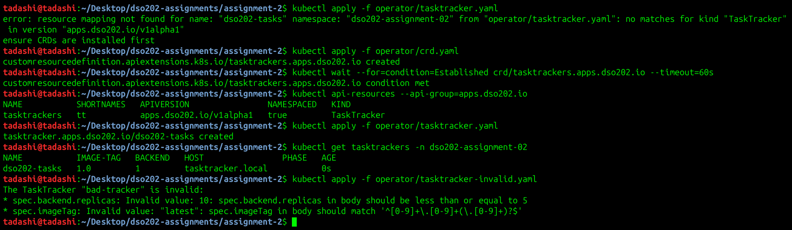

1. Applying the CR **before** the CRD fails with `no matches for kind "TaskTracker"` (notes §2.4.9).
2. After the CRD is `Established`, `kubectl api-resources` lists the new type, and the valid CR is stored.
3. The invalid CR (`imageTag: latest`, `replicas: 10`) is **rejected by the API server** with two validation errors, so it never reaches etcd.

### Evidence — a CRD alone does nothing, and aggregated ClusterRoles

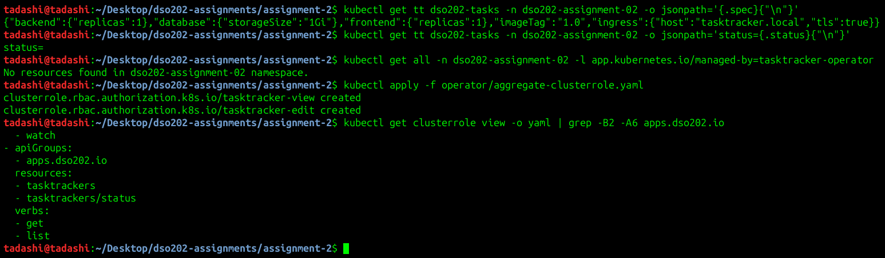

The CR is stored with defaults applied, but **`status` is empty and no resources were created**. No controller is watching this type. That's the key misconception in the notes: *a CRD only defines a new object type; an Operator is the running controller that acts on it.* A real Operator would run a **level-based** reconcile loop: read `spec`, compare it with the actual Deployments and StatefulSet, create or patch them, then write `status.phase` and `status.observedGeneration`. For production PostgreSQL that is what CloudNativePG or the Zalando operator already do (failover, backups, replicas), so a team should adopt an existing Operator before writing a new one.

`tasktracker-view` and `tasktracker-edit` carry the labels `rbac.authorization.k8s.io/aggregate-to-view` and `aggregate-to-edit`. The API server merged their rules into the built-in `view` ClusterRole (shown by `kubectl get clusterrole view`). That's why the `dev-team` group, bound only to `view`, can list TaskTrackers without the built-in role being edited by hand.

---

## Assignment 1 → Assignment 2 Summary

| Concern | Assignment 1 | Assignment 2 |
| --- | --- | --- |
| Database workload | Deployment + standalone PVC | StatefulSet + `volumeClaimTemplates` + `Retain` policy |
| Database address used by backend | `db-svc` | `db-0.db-svc` (stable ordinal identity) |
| External access | NodePort 30081 + port-forward; UI could not reach the API | One HTTPS Ingress host; UI and API on one origin |
| Encryption in transit (client side) | none (HTTP) | TLS terminated at the Ingress controller; HTTP → 308 → HTTPS |
| NodePorts allowed by quota | 1 | 0 |
| CORS | `*` | `https://tasktracker.local` |
| Pod identity | `default` SA, token mounted | dedicated SA per tier, no token |
| Human access | admin kubeconfig only | x509 user `tadashi` / group `dev-team`, own context, least privilege |
| CI/CD identity | — | `deployer` SA: create/update/patch, no delete, no Secrets |
| App-level API | — | `TaskTracker` CRD with schema validation + aggregated RBAC |
