# DSO202 — Assignment 3: Packaging Assignment 2 with Kustomize and Helm

| Unit 4 topic | How it is applied here |
| --- | --- |
| **Kustomize: base and overlays** | `kustomize/base/` holds the Assignment 2 stack once, as plain YAML. Two thin overlays (`dev`, `prod`) hold only what differs. Both are deployed side by side in their own namespaces. |
| **Kustomize: compose, transform, patch** | `resources:` composition, plus the `namespace:`, `labels:` (selectors untouched), `replicas:` and `images:` transformers. Strategic-merge patches and JSON 6902 patches (file and inline, including `~1` escaping). |
| **Kustomize: generators** | `configMapGenerator` (from `.env` files, with `behavior: merge` in the overlays) and `secretGenerator` (credentials and a `kubernetes.io/tls` Secret). The demo shows a content change producing a new hash and a rollout. |
| **Kustomize: render first, then diff, apply, delete** | Every change was checked with `kubectl kustomize`, then `kubectl diff -k`, then applied with `kubectl apply -k`, then a final `diff` confirmed no drift (exit code 0). `delete -k` was run as a server dry run. |
| **Helm: chart structure** | Chart `task-tracker` with `Chart.yaml` (chart `version` vs `appVersion`, `kubeVersion`), `values.yaml`, a `values.schema.json`, `_helpers.tpl` named templates, `NOTES.txt`, a test hook and `.helmignore`. |
| **Helm: templates** | Recommended labels with a separate stable selector set, name truncation, `required`, `default`, `toYaml \| nindent`, `with`/`range`/`if`, and the `checksum/config` rollout annotation. |
| **Helm: values and validation** | Environment files kept outside the chart (`helm/environments/`). Four failure classes are reproduced: a missing required value, a schema pattern, schema type/range, and a YAML float (`1.10` becomes `1.1`). `helm lint` alone is shown to be insufficient. |
| **Helm: release lifecycle** | `install`, `test`, `upgrade` (a config change rolls Pods), a failed upgrade, `--rollback-on-failure`, `rollback`, `history`, `uninstall` and a reinstall with data intact. |
| **Helm 4: server-side apply and drift** | A `kubectl scale` behind Helm's back makes the next upgrade fail with a field-manager conflict. `--force-conflicts` takes the field back. |

**Running now:** three copies of the application, each reachable through the same NGINX Ingress controller under its own host name.

| Deployed by | Namespace | Host | Frontend / backend replicas | DB volume |
| --- | --- | --- | --- | --- |
| Kustomize `overlays/dev` | `dso202-a3-dev` | `dev.tasktracker.local` (HTTP and HTTPS) | 1 / 1 | 1Gi |
| Kustomize `overlays/prod` | `dso202-a3-prod` | `prod.tasktracker.local` (HTTPS only) | 2 / 2 + PodDisruptionBudgets | 2Gi |
| Helm release `task-tracker` (chart 0.2.0, `environments/prod.yaml`) | `dso202-a3-helm` | `helm.tasktracker.local` (HTTPS only) | 2 / 2 | 2Gi |

---

## Repository Structure

```
assignment-3/
├── kustomize/
│   ├── base/                          # shared truth = the Assignment 2 architecture
│   │   ├── kustomization.yaml         # resources, labels, images, configMap/secret generators
│   │   ├── serviceaccounts.yaml       # frontend-sa / backend-sa / db-sa (no API token)
│   │   ├── rbac-viewer.yaml           # read-only SA + Role + RoleBinding (no Secrets)
│   │   ├── quota.yaml                 # ResourceQuota (nodeports 0) + LimitRange
│   │   ├── database.yaml              # headless db-svc + StatefulSet db (volumeClaimTemplates)
│   │   ├── backend.yaml / frontend.yaml   # ClusterIP Service + Deployment each
│   │   ├── ingress.yaml               # TLS + /api and / routing; host is a placeholder
│   │   ├── config/app.env, db.env, db-credentials.env   # generator inputs
│   │   └── tls/                       # tasktracker.crt/.key - generated, git-ignored
│   └── overlays/
│       ├── dev/                       # namespace, replicas 1, merge config, inline JSON 6902
│       └── prod/                      # namespace, replicas 2, SMP + JSON 6902 patches, PDBs
├── helm/
│   ├── task-tracker/                  # the chart
│   │   ├── Chart.yaml                 # version 0.2.0, appVersion "1.0"
│   │   ├── values.yaml                # documented defaults = the chart's interface
│   │   ├── values.schema.json         # types, enums, patterns, ranges
│   │   ├── .helmignore
│   │   └── templates/
│   │       ├── _helpers.tpl           # names, labels, selector labels, image, secret name
│   │       ├── serviceaccounts.yaml, viewer-rbac.yaml, governance.yaml
│   │       ├── configmap.yaml, secret.yaml (only without existingSecret)
│   │       ├── database.yaml, backend.yaml, frontend.yaml, ingress.yaml
│   │       ├── NOTES.txt
│   │       └── tests/test-api.yaml    # helm test hook
│   └── environments/
│       ├── dev.yaml
│       └── prod.yaml
├── scripts/make-tls.sh                # one self-signed cert for every A3 host
├── assets/                            # screenshots
├── evidence/                          # raw terminal transcripts behind every screenshot
└── .gitignore                         # *.key *.crt *.tgz
```

### How to deploy

The NGINX Ingress controller from Assignment 2 must already be running, and the three tutor images must be loaded on the kind nodes (see the Assignment 1 report).

```bash
cd assignment-3
./scripts/make-tls.sh                                  


kubectl kustomize kustomize/overlays/dev
kubectl apply -k kustomize/overlays/dev
kubectl apply -k kustomize/overlays/prod


kubectl create namespace dso202-a3-helm
kubectl create secret generic task-tracker-db-credentials -n dso202-a3-helm \
  --from-env-file=kustomize/base/config/db-credentials.env
kubectl create secret tls tasktracker-tls -n dso202-a3-helm \
  --cert=kustomize/base/tls/tasktracker.crt --key=kustomize/base/tls/tasktracker.key
helm lint helm/task-tracker -f helm/environments/prod.yaml
helm install task-tracker helm/task-tracker -n dso202-a3-helm -f helm/environments/prod.yaml --wait
helm test task-tracker -n dso202-a3-helm


kubectl port-forward -n ingress-nginx svc/ingress-nginx-controller 8443:443 8088:80
curl --cacert kustomize/base/tls/tasktracker.crt \
  --resolve prod.tasktracker.local:8443:127.0.0.1 https://prod.tasktracker.local:8443/api/tasks
```

---

## Part A — Kustomize

### A.1 Design: what goes in the base and what goes in an overlay

The rule from the notes is: *the base stores what is shared, the overlay stores what is different, and Kustomize renders the final YAML.*

| Setting | Base | `dev` overlay | `prod` overlay | Kustomize feature |
| --- | --- | --- | --- | --- |
| Namespace | none | `dso202-a3-dev` | `dso202-a3-prod` | `namespace:` + `namespace.yaml` |
| Environment label | `part-of`, `managed-by` | `environment: dev` | `environment: prod` | `labels:` with `includeSelectors: false` |
| Image tags | `1.0` for all three tiers | inherited | inherited | `images:` |
| Replicas (frontend / backend) | 1 / 1 | 1 / 1 | 2 / 2 | `replicas:` |
| `CORS_ORIGIN`, `LOG_LEVEL` | `tasktracker.local`, `info` | `dev.…`, `debug` | `prod.…`, `warn` | `configMapGenerator` `behavior: merge` |
| Backend resources | 100m/128Mi → 500m/256Mi | inherited | 200m/192Mi → 1/384Mi | strategic-merge patch |
| ResourceQuota | 1 CPU, 1Gi, 8 Pods, 2Gi storage | inherited | 2 CPU, 2Gi, 12 Pods, 3Gi storage | strategic-merge patch |
| DB volume | 1Gi | inherited | 2Gi | JSON 6902 (`/spec/volumeClaimTemplates/0/...`) |
| Ingress host | placeholder | `dev.tasktracker.local` | `prod.tasktracker.local` | JSON 6902 (inline in dev, file in prod) |
| `ssl-redirect` | `"true"` | `"false"` (plain HTTP allowed) | `"true"` | JSON 6902 `replace`, key escaped `~1` |
| `proxy-body-size` | `1m` | inherited | `512k` | JSON 6902 `replace` |
| Owner annotation | none | none | `dso202.io/owner: platform-team` | JSON 6902 `add`, key escaped `~1` |
| PodDisruptionBudgets | none | none | backend and frontend, `minAvailable: 1` | extra `resources:` entry |

Design decisions worth noting:

- **Patch style follows the decision table in the notes.**
  - Backend resources and the quota are strategic-merge patches. They read like Kubernetes YAML, and the backend container is matched by name.
  - The PVC size lives inside `volumeClaimTemplates`, a list that strategic merge cannot key reliably. The Ingress host sits at an exact array index. Both are therefore JSON 6902 patches.
  - The dev patch is three lines, so it stays inline. The prod patches have their own files.
- **There is no `namePrefix`.** The backend reaches PostgreSQL at `db-0.db-svc`, a value inside a ConfigMap. Kustomize rewrites name *references* (`serviceName`, `configMapRef`, `secretKeyRef`, Ingress backends), but not a host name written inside a config value. A prefix would rename the Service and break that address. Separate namespaces isolate the environments instead.
- **There are two ConfigMap generators.** `app-config` feeds the backend and frontend, and `db-config` feeds PostgreSQL. An application setting change therefore changes only `app-config`'s hash, and the database Pod is never restarted for it (shown in A.4).
- **Selectors are never labelled.** `includeSelectors: false` keeps `spec.selector` unchanged. Deployment and StatefulSet selectors are immutable, and Service selectors route traffic.

Files: [`base/kustomization.yaml`](kustomize/base/kustomization.yaml), [`overlays/dev/kustomization.yaml`](kustomize/overlays/dev/kustomization.yaml), [`overlays/prod/kustomization.yaml`](kustomize/overlays/prod/kustomization.yaml).

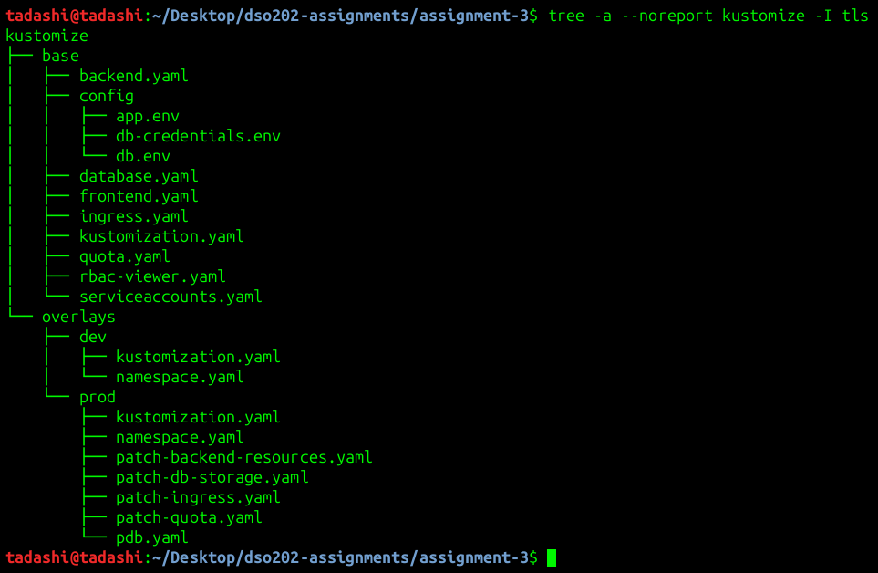

### A.2 Render first

Rendering never touches the cluster. Prod renders two more objects than dev (the PodDisruptionBudgets).

Every generated object gets a content-hash suffix, and Kustomize rewrites each reference to it automatically. In the output below, the Deployments, the StatefulSet and the Ingress `secretName` all point to `…-8km6k6h8b5` and `…-ctctthhc2k`; none of those hashes was written by hand. Evidence: [`k02-build.txt`](evidence/k02-build.txt).

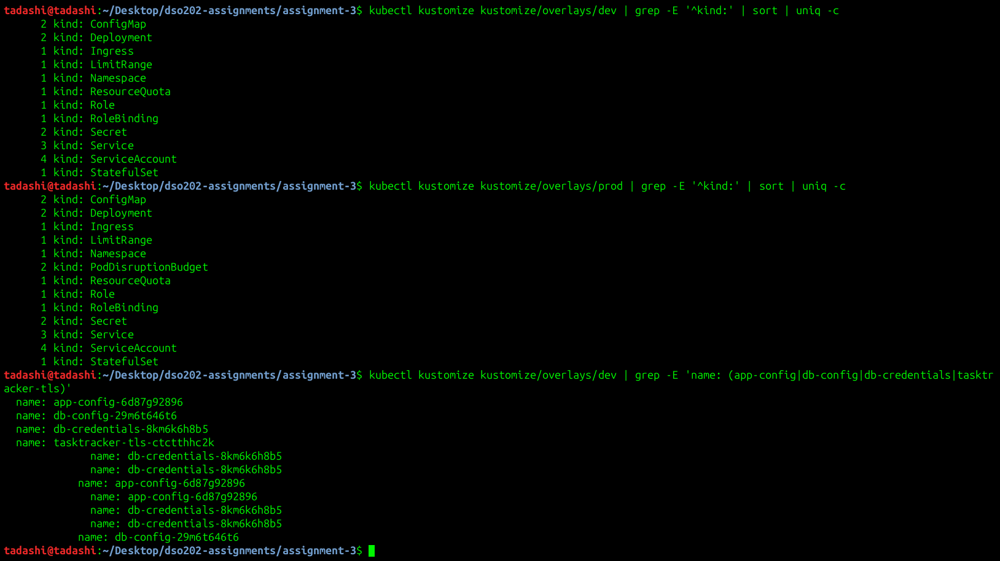

### A.3 Apply both overlays and check the result

`kubectl apply -k` creates the namespace first and then everything inside it ([`k03-apply.txt`](evidence/k03-apply.txt)).

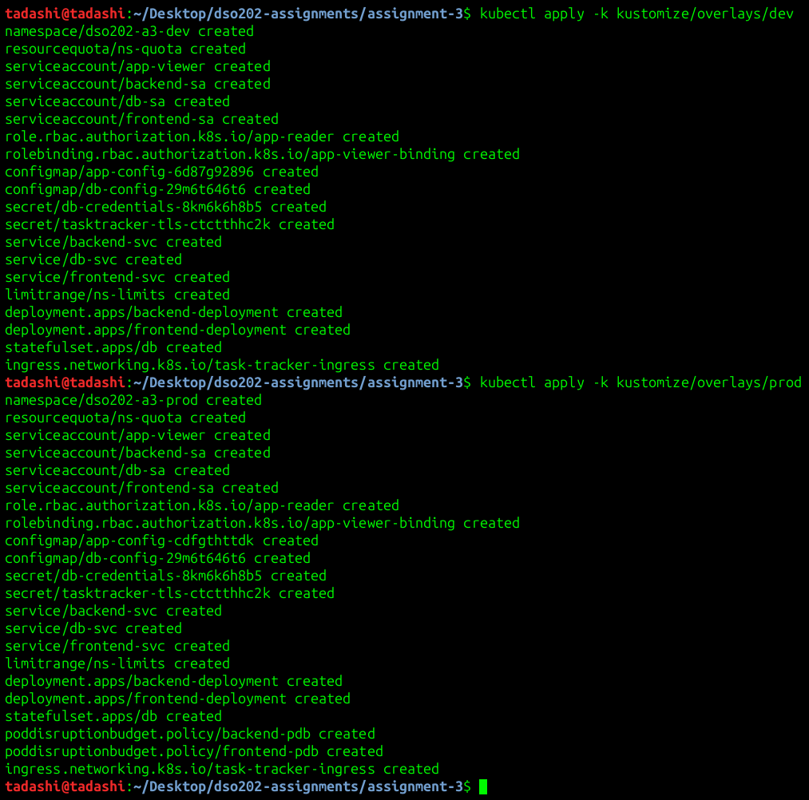

Both environments are running from the same base. The prod overlay produced 2+2 replicas, a 2Gi PVC and two PDBs ([`k04-running.txt`](evidence/k04-running.txt)).

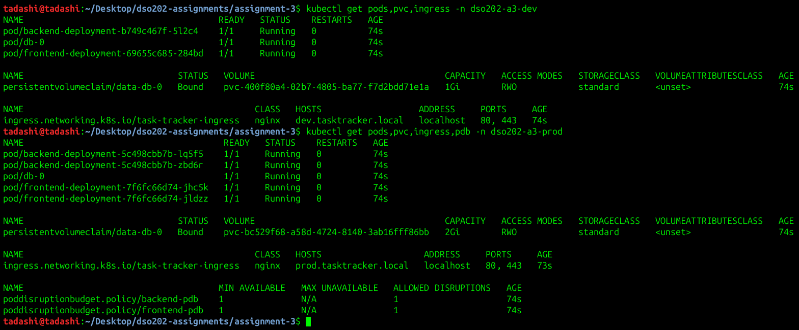

Each overlay change is visible on the live objects ([`k05-overlays.txt`](evidence/k05-overlays.txt)):

- the environment label;
- the strategic-merge resource patch;
- the three JSON 6902 annotation changes;
- the merged generator values per namespace;
- the patched prod quota (750m of 2 CPU in use).

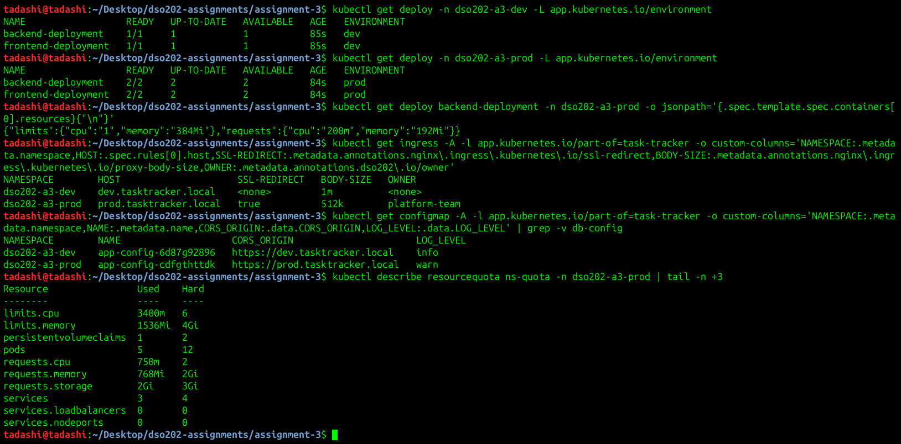

### A.4 Generator hash: a content change triggers a rollout

The notes call this *the most valuable Kustomize idea to demonstrate live*. Changing one line (`LOG_LEVEL=info` to `debug`) in the dev overlay set off this chain:

1. The content changed, so the hash changed: `app-config-6d87g92896` became `app-config-4t7ftdh5gf`.
2. Kustomize rewrote the reference in both Deployments, so `kubectl diff` showed the `envFrom` name change.
3. The Pod template changed, so both Deployments rolled out new ReplicaSets.
4. `db-0` was **not** restarted (still 2m1s old), because `db-config` did not change. This is the reason for the two-generator design.

The old ConfigMap is left behind as an orphan: nothing in the build references it any more. Section A.6 cleans it up.

Evidence: [`k06-generator-rollout.txt`](evidence/k06-generator-rollout.txt).

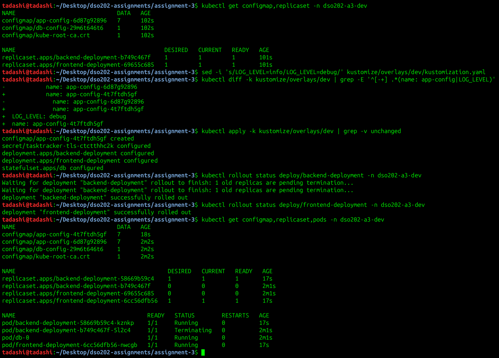

### A.5 Traffic through the Ingress: the overlays behave differently

Evidence: [`k08-ingress.txt`](evidence/k08-ingress.txt).

- **dev:** plain HTTP returns `200`.
- **prod:** plain HTTP returns `308` to HTTPS.
- **CRUD:** each environment has its **own database**. Prod has task #5 "Deployed by Kustomize (prod)" and dev has #4 "Deployed by Kustomize (dev)".
- **Body size, prod:** a 700 KB body is rejected by **NGINX** (`413` with no `X-Powered-By`), because prod's limit is 512k.
- **Body size, dev:** the same body passes NGINX (limit 1m) and is rejected by the **application** instead (`413` with `X-Powered-By: Express`, whose body-parser limit is 100 KB). One annotation changed which layer enforces the limit.

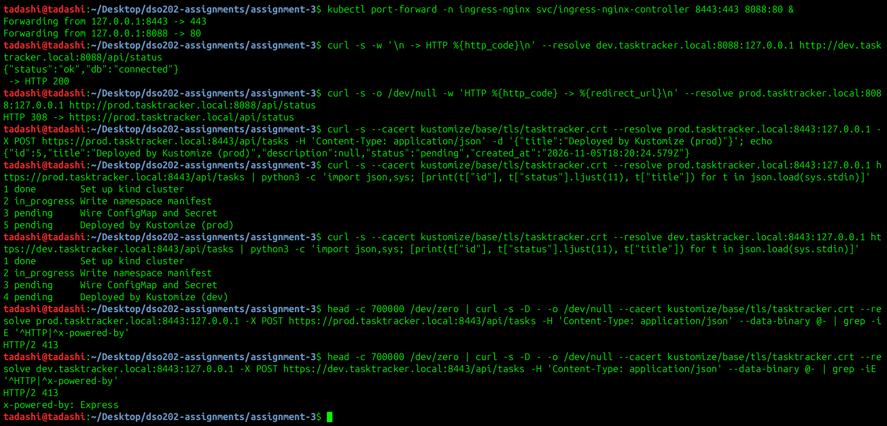

**Pitfall found and fixed.** The first dev patch used `op: remove` on the `ssl-redirect` annotation, and dev still answered `308`. ingress-nginx redirects to HTTPS by default whenever the host has a TLS block, so *removing* the annotation is not the same as *disabling* the redirect. The fix is `op: replace` with `value: "false"`.

This is the notes' rule that *rendered YAML is the truth* taken one step further. The render was correct; the controller's default behaviour was the missing piece. Evidence: [`k08-before-fix.txt`](evidence/k08-before-fix.txt).

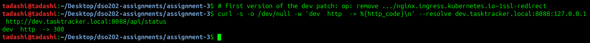

### A.6 Diff as a drift check, orphan cleanup, delete

`kubectl diff -k` returns exit code `0` for both overlays: the cluster matches the rendered YAML exactly.

The orphaned ConfigMap from A.4 no longer appears in the build, so it was deleted by hand. In a pipeline, `kubectl apply --prune` or a GitOps controller would do this.

`kubectl delete -k … --dry-run=server` lists everything the overlay owns, including the namespace, without deleting anything. Evidence: [`k07-diff.txt`](evidence/k07-diff.txt), [`k09-orphan-delete.txt`](evidence/k09-orphan-delete.txt).

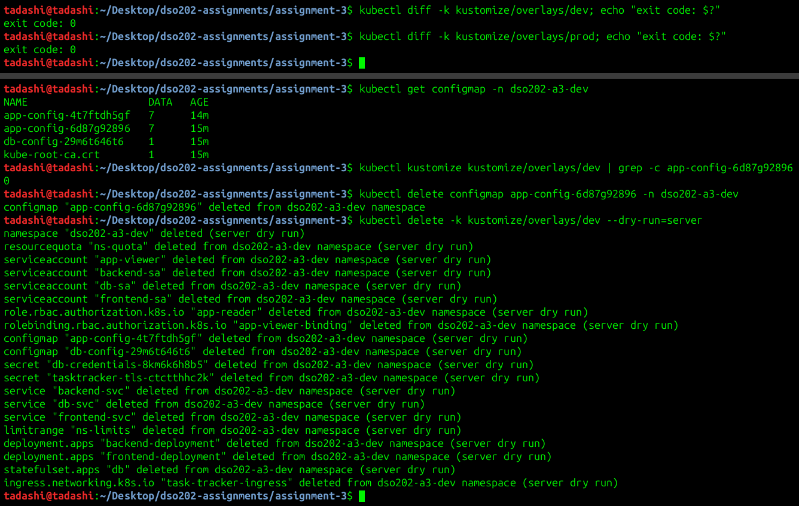

A side note: re-running `kubectl apply -k` prints `configured` for four objects (the TLS Secret, the StatefulSet and the two PDBs), even though `kubectl diff` reports nothing to change. This is a cosmetic effect of client-side apply's three-way patch calculation. `kubectl diff` is the authoritative check.

---

## Part B — Helm

### B.1 Chart design

| File | Purpose |
| --- | --- |
| [`Chart.yaml`](helm/task-tracker/Chart.yaml) | `apiVersion: v2`, `version: 0.2.0` (the chart), `appVersion: "1.0"` (the images, quoted so YAML keeps it a string), `kubeVersion: ">=1.30.0-0"` |
| [`values.yaml`](helm/task-tracker/values.yaml) | Every key is commented. `environment` and `ingress.host` have **no default** on purpose. |
| [`values.schema.json`](helm/task-tracker/values.schema.json) | Enums (`environment`, `pullPolicy`, `logLevel`), patterns (image tags must be `MAJOR.MINOR[.PATCH]`, sizes like `2Gi`, `proxyBodySize`, the host), replica range 1–5, and string-typed tags |
| [`_helpers.tpl`](helm/task-tracker/templates/_helpers.tpl) | `fullname` (63-character truncation, no `task-tracker-task-tracker`). A **stable** `selectorLabels` set (`name`, `instance`, `component`) kept apart from the full `labels` set (`helm.sh/chart`, `version`, `managed-by`, `environment`). Image and secret-name helpers. |
| [`configmap.yaml`](helm/task-tracker/templates/configmap.yaml) | Computes `DB_HOST` as `<release>-db-0.<release>-db`, so the StatefulSet address follows the release name |
| [`secret.yaml`](helm/task-tracker/templates/secret.yaml) | Rendered **only** when `database.auth.existingSecret` is empty. `required` then demands a username and password. |
| [`backend.yaml`](helm/task-tracker/templates/backend.yaml), [`frontend.yaml`](helm/task-tracker/templates/frontend.yaml) | `checksum/config` Pod annotation (sha256 of the rendered ConfigMap), so a config change rolls the Pods. This is Helm's equivalent of Kustomize's hash suffix. |
| [`database.yaml`](helm/task-tracker/templates/database.yaml) | Headless Service + StatefulSet with `persistentVolumeClaimRetentionPolicy: Retain` |
| [`ingress.yaml`](helm/task-tracker/templates/ingress.yaml) | The TLS block appears only when `tlsSecretName` is set (`with`). Extra annotations are quoted one by one (`range`), never passed raw through `toYaml`. |
| [`governance.yaml`](helm/task-tracker/templates/governance.yaml), [`viewer-rbac.yaml`](helm/task-tracker/templates/viewer-rbac.yaml), [`serviceaccounts.yaml`](helm/task-tracker/templates/serviceaccounts.yaml) | Quota, LimitRange, read-only viewer and per-tier ServiceAccounts, each switchable from values |
| [`tests/test-api.yaml`](helm/task-tracker/templates/tests/test-api.yaml) | `helm.sh/hook: test` Pod that checks the frontend page, `/api/status` (`db: connected`) and `/api/tasks`. It reuses the frontend image, so no extra image is pulled. |

**Secrets are handled the way the notes recommend.** The notes warn that every value given to a release is stored in its release record, so prod uses `database.auth.existingSecret`. The credentials Secret is created with `kubectl` before the install. The dev values file shows the other path (the chart creates the Secret from values) and is labelled dev-only.

**Environment files live outside the chart** (`helm/environments/`), because they belong to a *deployment* of the chart. `prod.yaml` sets every key prod relies on, so it never inherits another environment's values. The notes show how layering `-f dev.yaml -f prod.yaml` leaks settings between environments.

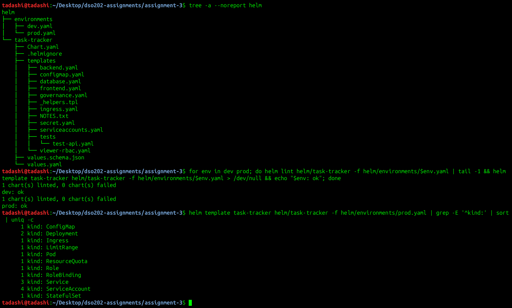

### B.2 Validation before anything reaches the cluster

Each check catches a different class of error. Evidence: [`h02-validation.txt`](evidence/h02-validation.txt).

| Input | Caught by | Result |
| --- | --- | --- |
| No values file (no `environment`) | `required` in `_helpers.tpl` | `helm template` stops: `environment must be set (dev, staging or prod)` |
| The same chart, linted | `helm lint` | Only **warnings**, `0 chart(s) failed`, exit code **0**. A pipeline that runs only `helm lint` would pass a chart that cannot render. |
| `--set image.tag=latest` | schema `pattern` | `'latest' does not match pattern` |
| `replicaCount=10`, `environment=test`, `proxyBodySize=1MB` | schema `maximum`, `enum`, `pattern` | All three violations reported at once |
| A YAML file with `tag: 1.10` (unquoted) | schema `type: string` | `got number, want string`. Without the schema, YAML reads `1.10` as `1.1` and the image becomes `dso202-backend:1.1`. |
| Dev values with an empty password | `required` in `secret.yaml` | `database.auth.password is required when database.auth.existingSecret is empty` |

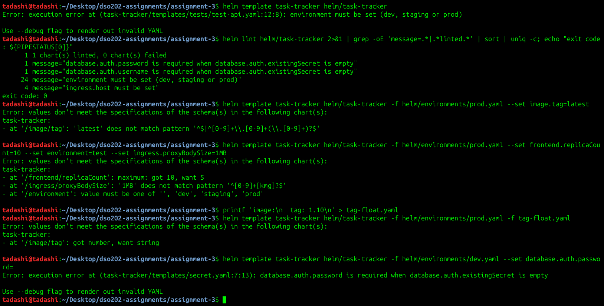

### B.3 Install, release record and ownership

Evidence: [`h03-install.txt`](evidence/h03-install.txt), [`h04-release.txt`](evidence/h04-release.txt).

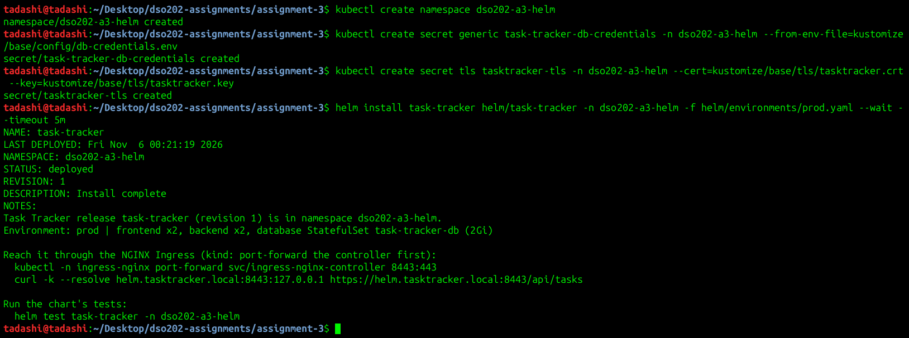

What the release looks like in the cluster:

- **`helm list`** shows the chart (`task-tracker-0.2.0`) and the app version (`1.0`).
- **The release record** is the Secret `sh.helm.release.v1.task-tracker.v1`.
- **Ownership markers:** the label `app.kubernetes.io/managed-by: Helm` and the annotations `meta.helm.sh/release-name` and `meta.helm.sh/release-namespace` are on every object.
- **No password in the release:** `helm get values` shows only `existingSecret: task-tracker-db-credentials`. Decoding the release record and searching it for the password returns `0` matches.

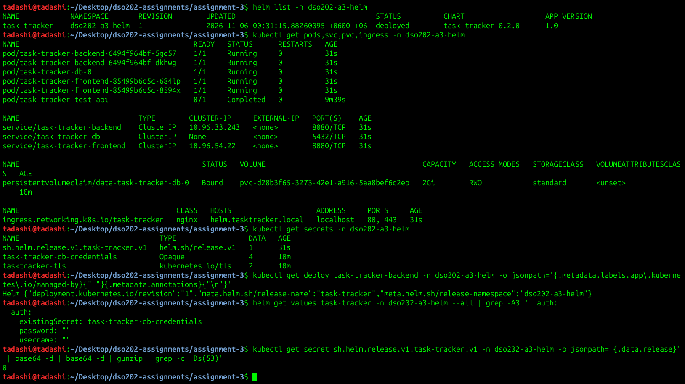

### B.4 `helm test` and a manifest drift check

The test Pod confirmed:

- the frontend page title;
- `{"status":"ok","db":"connected"}`;
- four tasks returned.

`helm get manifest | kubectl diff -f -` returns exit code `0`: the live objects match the release exactly. Evidence: [`h05-test.txt`](evidence/h05-test.txt).

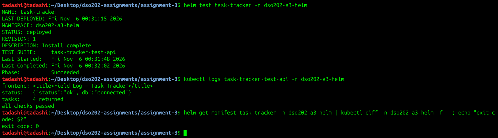

### B.5 Upgrade: a configuration change rolls the Pods

One value changed (`backend.logLevel=info`), passed together with the full prod values file, as the notes advise against partial `--set` upgrades.

- The ConfigMap changed, so the sha256 in `checksum/config` changed (`74ad85…` to `5e4c83…`).
- The Pod template changed, so a new backend ReplicaSet was created and the old one scaled to 0.
- Revision 2 was recorded. Evidence: [`h06-upgrade.txt`](evidence/h06-upgrade.txt).

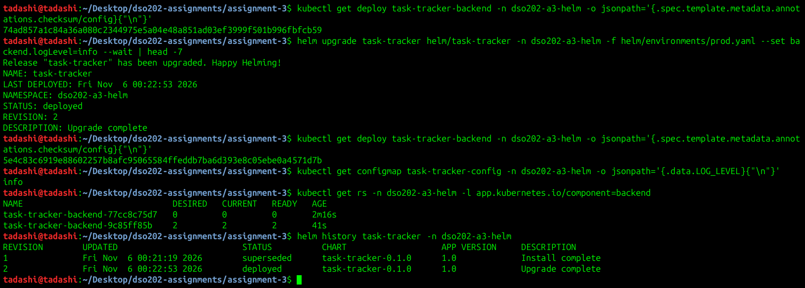

### B.6 A failed upgrade exposed a chart design flaw (chart 0.1.0)

`--set image.tag=9.9` (a tag that does not exist) was upgraded with `--rollback-on-failure --timeout 90s`. In chart **0.1.0**, `image.tag` was shared by **all three tiers**, so the bad tag also replaced the PostgreSQL image. The chain of failures:

1. `db-0` went to `ErrImagePull`.
2. The healthy backend Pods lost their database and failed readiness.
3. Helm's automatic rollback (revision 4) **also timed out**. It waited for a StatefulSet that could not recover on its own.

Evidence: [`h07-failed-upgrade.txt`](evidence/h07-failed-upgrade.txt).

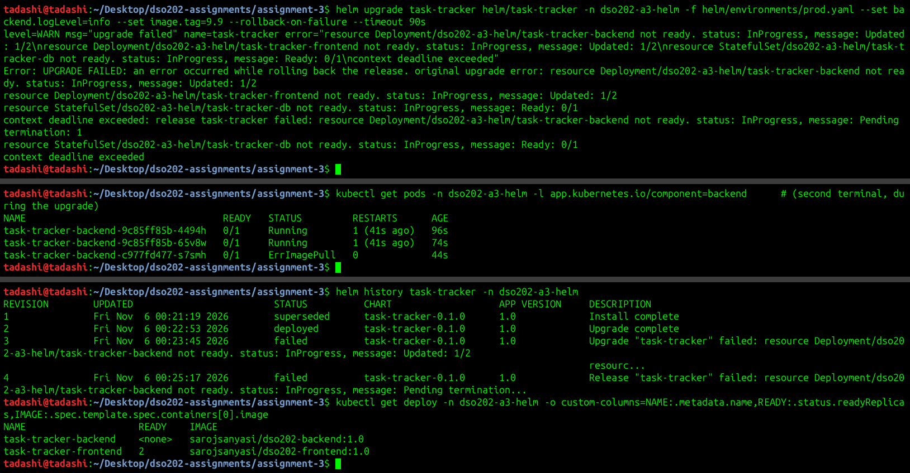

Kubernetes documents this behaviour as the StatefulSet *forced rollback* limitation. Reverting the template is not enough: a Pod already stuck with the bad template must be deleted by hand. The output shows the StatefulSet spec back on `1.0` while the Pod is still on `9.9`.

After `kubectl delete pod task-tracker-db-0`, the database came back with its data intact, the backend recovered, and `helm rollback task-tracker 2` recorded revision 5. Evidence: [`h07d-recover.txt`](evidence/h07d-recover.txt).

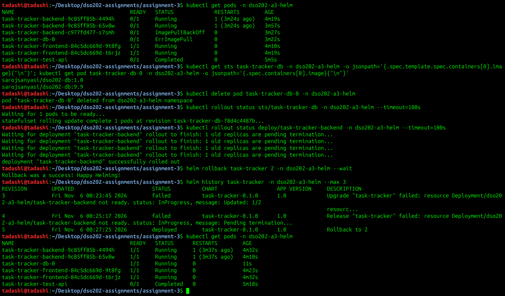

### B.7 The fix: chart 0.2.0 and a clean automatic rollback

**The fix.** The database image now has its own `database.image.tag`, and `image.tag` applies only to the app tiers.

- Because a chart file changed, the chart `version` was bumped to **0.2.0**, while `appVersion` stayed at `1.0`. This is the notes' *chart-only change*.
- The schema validates the new key.
- The upgrade to 0.2.0 is revision 6.

**The same bad upgrade, repeated:**

- `db-0` kept the same start time and image.
- Only the app tiers tried `9.9`.
- `--rollback-on-failure` rolled back by itself ("has been rolled back due to rollback-on-failure being set", exit code 1).
- History shows revision 7 `failed` and revision 8 "Rollback to 6", and the Pods are healthy.

Evidence: [`h08-rollback-on-failure.txt`](evidence/h08-rollback-on-failure.txt).

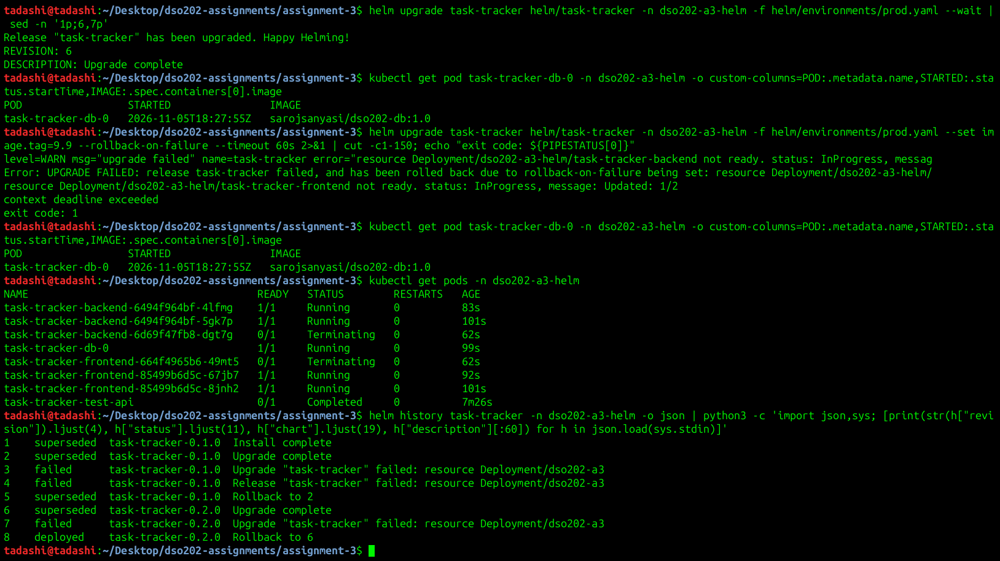

### B.8 Helm 4 server-side apply: drift becomes a conflict

`kubectl scale … --replicas=4` moved ownership of `.spec.replicas` from the `helm` field manager to `kubectl` (subresource `scale`), as the `managedFields` output shows.

- The next `helm upgrade` refused to overwrite the field silently. It failed with `conflict with "kubectl" with subresource "scale" … .spec.replicas`.
- `--force-conflicts` took ownership back and returned the Deployment to the chart's 2 replicas.

This is the 3.2.3.2 behaviour from the notes: under client-side apply (Helm 3), the drift would have been overwritten without warning. Evidence: [`h09-drift.txt`](evidence/h09-drift.txt).

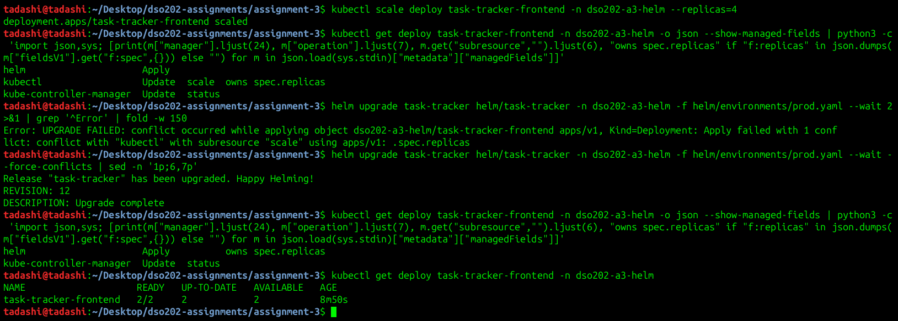

### B.9 Uninstall and reinstall: the data survives

Evidence: [`h10-uninstall-reinstall.txt`](evidence/h10-uninstall-reinstall.txt).

1. Task #4 "Survives helm uninstall" was created through the Ingress.
2. `helm uninstall` removed every release object and its release records.
3. What stayed in the namespace:
   - **The PVC `data-task-tracker-db-0`.** The StatefulSet controller created it, not Helm, and the retention policy is `Retain`.
   - **The two Secrets created with `kubectl`.** They were never part of the release.
   - **The completed test Pod.** Hook resources are not release objects; its `before-hook-creation` policy replaces it on the next `helm test`.
4. A fresh `helm install` (a new revision 1) re-attached the **same volume** (`pvc-d28b3f65…`), and task #4 was still there.

The full revision history (revisions 1–12) was deleted with the old release because `--keep-history` was not used. Sections B.5–B.8 show it in their screenshots.

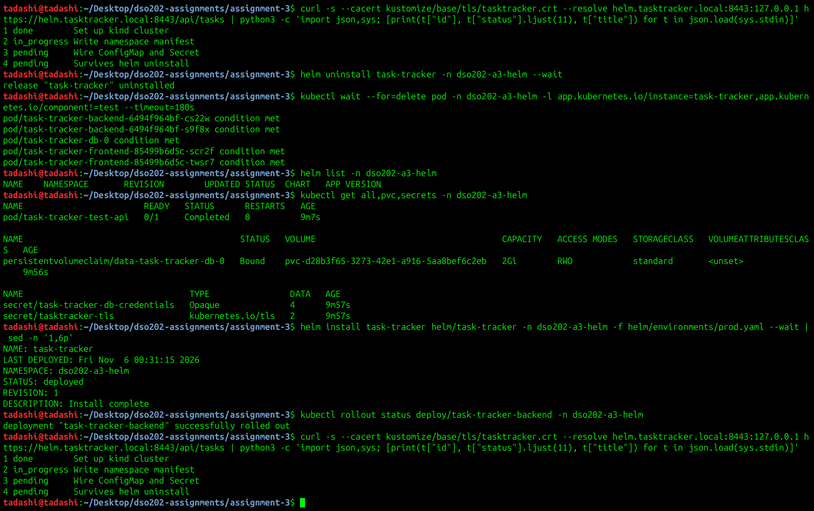

---

## Browser evidence

Both pages were captured with headless Chrome through the NGINX Ingress over HTTPS. Each host shows **its own database**.

| Kustomize prod: `https://prod.tasktracker.local` | Helm release: `https://helm.tasktracker.local` |
| --- | --- |
| 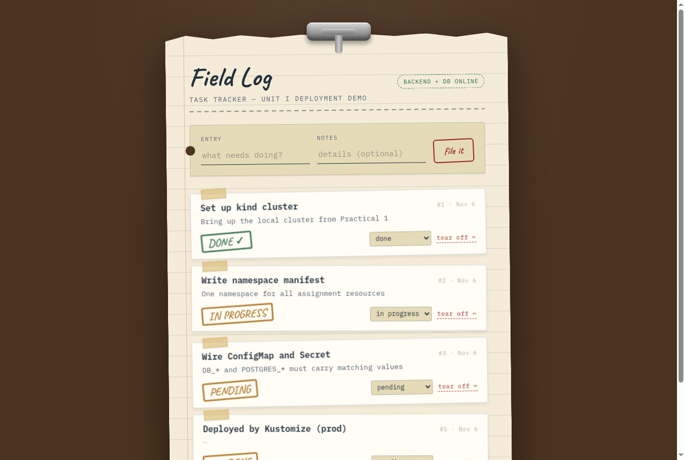 |  |

---

## Kustomize vs Helm, judged on this application

| Aspect | Kustomize (Part A) | Helm (Part B) |
| --- | --- | --- |
| Input files | Valid Kubernetes YAML; the base can be read and applied as is | Templates that are not YAML until rendered; harder to read, far more flexible |
| Environment differences | Overlays with patches; each difference is a visible diff against the base | Values files; each difference is one key, validated by a schema |
| Config change → rollout | Generated-name hash; the old ConfigMap is left orphaned | `checksum/config` annotation; the ConfigMap is updated in place |
| Input validation | None before the API server (the CRD in Assignment 2 is one way to add it) | `required`, `fail` and `values.schema.json` catch errors before anything is sent |
| What was installed? | Not recorded; `kubectl diff -k` against Git is the only record | Release record, revision history, `helm get values/manifest` |
| Rollback | Revert the Git commit and apply again | `helm rollback`, or automatic with `--rollback-on-failure` |
| Removal | `kubectl delete -k` (it also deletes the namespace the overlay owns) | `helm uninstall` (namespace, out-of-band Secrets and StatefulSet PVCs stay) |
| Drift | `kubectl diff -k` shows it; client-side apply overwrites it | Helm 4 server-side apply **fails** on it until `--force-conflicts` |
| Best fit here | Our own manifests, environment variants, GitOps-friendly | Packaging the app for others, with lifecycle management and safe upgrades |

The two tools complement each other, as the notes say. A common industry pattern is to install a chart with Helm and apply organisation-specific patches with Kustomize.

---

